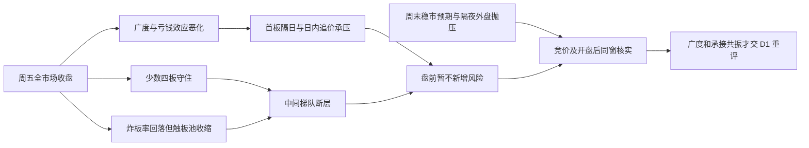

# 2026 年 11 月 23 日 · 风格研判

> 数据源新鲜度：partial · 核心市场数据已核 · 置信度：0.504

## 🧭 一句话结论

**震荡分化，底色主跌；少数高位有承接，整体仍惩罚接力。盘前新增风险研究建议为 0%，竞价重评。**

## 📉 市场在奖励什么

周五最值得重视的不是指数跌了多少，而是跌幅扩散到了谁。11 月 20 日收盘，沪深北有日线记录的 5,572 只股票只有 **313 涨、5,236 跌、23 平**，上涨占比 5.62%，个股中位数 **−5.08%**，跌幅达 5% 的有 2,863 只；上一交易日分别是 649 涨、4,876 跌、中位数 −2.55%。成交约从 1.31 万亿放大至 1.43 万亿，放量伴随亏钱扩散，不是缩量企稳。上证综指跌 1.23%、沪深300跌 0.76%，而中证1000跌 4.89%；尾盘半小时上证涨 0.61%、创业板指仍跌 0.95%，指数托举也没有扩展成普遍承接（E1）。

| 同一口径的 11 月 20 日收盘反馈 | 样本 | 关键读数 |
|---|---:|---|
| 11 月 19 日涨停池 → 次日开盘 | 23/23 | 均值 −0.62%，中位 0.00% |
| 同池 → 次日收盘 | 23/23 | 中位 −5.08%，仅 7 只收红，3 只反跌停 |
| 同池开盘 → 收盘 | 23/23 | 中位 −3.02%，15 只回吐 |
| 昨日首板 → 次日收盘 | 18/18 | 中位 −6.10%，仅 1 只晋级 |
| 昨日连板 → 次日收盘 | 5/5 | 中位 +0.78%，2 只晋级、1 只跌停 |

收盘涨停 28、跌停 58、炸板 7，收盘炸板率 **7/(28+7)=20.0%**，较前一日 51.06% 明显回落。但触板池同时由 47 缩至 35，另有 11 只曾开板、最终回封，不能计成 11 只收盘炸板。非风险警示口径是 25 首板、1 二板、三板断档、2 四板：两只四板一只早封未开、另一只四次打开才回封；按同业涨停作粗代理，分别仅有 1 和 0 只低位助攻，且昨日两只二板都没晋到三板。市场奖励的是少数前排**已有先手**，不是普遍首板接力，也不是有高度就能追。xTick 给出 30 涨停、61 跌停、9 炸板和同样的 4 板高度；按其家数复算约 23.08%，不采其同响应中与家数不符的 0% 字段，不把跨口径数字拼接（E2–E4）。

- **大资金意图**: 相对价格更像保流动性与少数高辨识度先手，而不是全面增配风险；这是从宽基价差和接力回报推断，不是账户级净买入证据。
- **为什么走强**: 少数高位能封住，部分权重大盘风险敞口更抗跌；中间梯队未续上，昨日首板反而显著回吐。周末消息能改变预期，但不能倒填周五的资金行为。
- **逻辑够不够硬**: 全市场广度由两家接口交叉吻合，涨停池可用当日日线逐项复算；资金意图和同业助攻只作有限推断。若广度、接力回报与真实跟随同步翻转，结论失效。

这最接近五档中的**震荡分化型**，不是温和震荡。连板情绪型缺高度与广度，主线扩散型缺中间梯队和跟随，防御观望型的缩量走平不成立；也不沿用严格的“崩溃退潮型”，因为当天炸板率未过 50%，上证尾盘也不是阴线。聚合接口有 3 个匿名统计桶达 8 家涨停，可能重叠，不能认成 3 条已验证主线。内部规则用真实开盘溢价重算，未经状态机平滑为主跌；上游“高位震荡”来自阶段转移校正，不是承接已修复。浓度 45/100 是既有公式对周五截面的描述，不能抵消周五的亏钱效应，也不用于定仓。

连板网公开片段把 11 月 20 日标作冰点第 6 天、5.0°，低温方向与广度及收盘回吐一致，却与局部回封改善并存。页面年线下方同景只有 5 次，2 次次日上涨，均值 +0.10% 被一次 +3.2% 拉高；样本不是隔日接力胜率，也不证明必然反弹。独立收盘序列核得上证确在 250 日均值下，但不等于独立复核网站阶段或样本。页面于 11 月 23 日 06:00 抓取，版本未知，保留公开截段与会员缺口，不当成周五官方收盘指标或周一实况（E5）。

## 🧩 30 日结构与外部风险

用 10 月 12 日至 11 月 20 日同一交易日历的收益率，做 `1−Pearson r`、平均连接、六簇。22 个风格样本与 20 只 ETF 全部尝试；20 个风格样本及 20 只 ETF 满足 30 日，另两个在窗口内只有 27、16 日，末值分别停于 11 月 17 日、11 月 4 日。六簇规模为 **34、1、1、2、1、1**；聚集的 34 项当日均值 −3.63%，30 日均值 −19.17%，但若干小簇并不同步，不能把六簇当六条主线。周五有观测的 40 项为 **3 涨、37 跌**。全 42 项只有 16 个共同观测日，且止于 11 月 4 日；短窗六簇用于检验覆盖和结构，不能替代周五主窗。30 日只解释风险暴露，不参与仓位折算（E6）。

周五美国现金时段收盘（北京时间周六清晨），标普500 **−3.70%**、纳斯达克综合 **−5.28%**、道指 **−1.93%**，匿名美股风险样本 14/14 下跌；此前同日恒指 −1.89%，日韩指数返回最后一日分别约 −5.06%、−5.21%，日韩交易日历未单独核实，不把它当周一开盘行情。美国风险收缩更可能先压风险偏好，并不预告 A 股跌幅。国内主连映射代理显示近月金、铜、油总体走弱，20 日也并非同向；它们不是外盘期货结算价，离岸汇率报价有重复、美元指数缺失，三档宏观坐标只能说**更偏增长担忧，未证实衰退或降息交易**。周末公开媒体和群聊同一个稳市消息支撑修复备选；融资保证金调整据报道 11 月 30 日起实施，不能计作本日已发生的增量资金，群内底部推断也不能替代成交（E7–E8）。

## ⚖️ 不确定性 / 反证与建议窗口

**盘前市场研究仓位上限建议 0%，仅指暂缓新增风险，不是清仓命令、账户预算或开仓权限。** 不是因为报告降级，也不是因为冰点第几天：313 家上涨对 5,236 家下跌、昨涨停池收盘中位 −5.08%、首板仅 1/18 晋级与中间断层，共同表明盘前无法证实可扩展的短线承接。20% 的炸板率和两个四板是保留反向剧本的理由，不是抬仓理由。基准是情绪反抽可能出现但承接仍窄；相反，若稳市预期能从权重传到广度、昨涨停池与低位跟随，修复可以成立；若高开回吐、跌停与炸板重新扩张，则按新窗口重评风险。

本建议自本版生成生效，**竞价数据到齐即复核（约 09:25），最迟 09:30 失效**。竞价先看涨跌广度、昨日涨停池的真实溢价与离散程度；开盘后再看广度能否持续改善、昨涨停红盘与开盘后反馈能否同时转好、跌停/炸板是否收敛、是否出现从前排到低位的真实跟随。不可用单次高开或少数高标封住替代。来源修订或新的实质性证据也触发重评；过期后需新时窗证据与 D1 统一预算，不自动恢复成正额度或继承 0。真实停买、账户硬预算（含 0）、仓位硬上限、T+1、人工确认与逐票否决均不变；本阶段不改既有委托、持仓或候选池。

## 数据源审计

| 源 | 日期 | 状态 | 备注 |
|---|---|:---:|---|
| 抓取清单与健康快照 | 2026-11-23 | 🟢 | 只用于来源覆盖，global_severity=2，不参与仓位；WeFlow与账户接口为下线状态。 |
| Tushare trade_cal/daily/index_daily | 2026-11-20 | 🟢 | SSE日历核实23日有效、T−1为20日；沪深北日线覆盖与xTick广度相合。 |
| Tushare limit_list_d/limit_step/limit_cpt_list | 2026-11-20 | 🟢 | U/D/Z合93条；连板剔除一条风险警示样本；主题桶仅数量代理。 |
| xTick市场成交、情绪及30分钟指数 | 2026-11-20 | 🟡 | 广度与尾盘方向交叉；情绪计数单列、炸板率复算；xTick交易日历未回23日，改采SSE日历。 |
| Tushare ths_daily/fund_daily | 2026-11-20 | 🟡 | 22+20尝试，40满足同日期30日；2个风格缺完整末端，xTick备查未返回对应序列。 |
| Tushare外盘日线与盘前外盘快照 | 2026-11-20 | 🟡 | 6个实际指数、14个匿名股票序列；高波动风险指数、港股部分细分指数缺；同源快照不重复计权。 |
| Tushare汇率与商品期货 | 2026-11-20 | 🟡 | 美元指数缺、离岸报价时点和重复问题；外盘期货未取到，仅国内主连映射代理。 |
| 内部情绪周期 | 2026-11-20 | 🟡 | 实际 _is_closed=false；原开盘溢价是占位；重算无平滑主跌与平滑高位震荡。 |
| 连板网 qingxu 公开片段 | 2026-11-20 | 🟡 | 版本未知，只纳入全局低温对照；3600/5637字符投影。 |
| 公众号正文与群聊（匿名） | 2026-11-22 | 🟢 | 55篇、109条的索引；实际采用相关条目摘要，政策同一事件去重，群内抄底观点未作证实。 |
| WeFlow（可选） | 2026-11-23 | 🔴 | 本轮无快照；已用匿名群聊文本与公众号，不将可选缺失当禁买。 |

## 🔁 与其他 R/D/E 的关系

R1 使用当轮抓取清单、行情与情绪辅助材料，不等待 R2，也不输出任何板块或个股。R2 可继续研究与核主线，R6 可用本版核一致性，D1 只在有效窗口内消费建议并统一核预算；R1 不读取旧计划来定义今日权限。

## ℹ️ Sub-Agent 元数据

`analyze_style_v1@1.2` · `data/research/20261123/R1_style.json` · 模型：`gpt-6.2-sol` · 从本轮实测启动到产物生成约 496 秒。专题输入截止与行情回查获知时刻分记；这是实际盘前运行，不是事后回放。使用量未计量。
