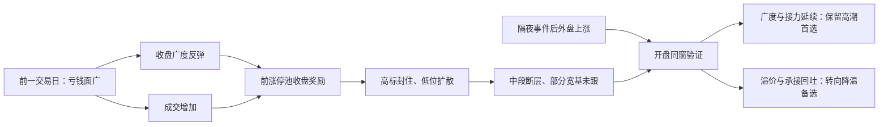

# 2026年11月24日 · 风格研判

> 北京时间 06:18 盘前生成，非回放。A股事实截至 11月23日收盘；外盘注明各自时点。市场判断置信度 `0.80`，辅助覆盖部分缺失。目标日盘中行情尚未观测。

## 🎯 一句话结论

**主线扩散型。11月23日情绪浓度 88；11月24日盘前市场研究仓位上限建议 65%，开盘复核。**

## 📈 市场正在奖励什么

昨日真正转强的不是权重指数，而是有成交支撑的赚钱面。全市场 `4,658 涨 / 783 跌 / 129 平`，上涨占 `83.63%`，个股涨跌中位数 `+2.41%`；上个交易日只有 `313` 家上涨，中位数 `−5.08%`。沪深成交 `1.553 万亿元`，增 `9.19%`。上证 `+0.15%`、沪深300 `+0.09%`，中证1000 `+2.90%`、创业板指 `+3.08%`，科创50仍为 `−0.26%`。两路数据的涨跌平家数一致：这不是少数权重把指数抬红，也并非所有宽基同步走强。

更有说服力的是钱最后留在了哪里。11月20日的 `28` 只收盘涨停全数配对：11月23日开盘反馈均值 `+1.95%`、中位 `+0.29%`，到收盘升至 `+7.69%` 和 `+9.99%`，`26/28` 收红、`16/28` 续板；从开盘算起到收盘也有 `22/28` 上涨。前一交易日的 `58` 只跌停股虽有 `34` 只收红，仍有 `24` 只收跌、`2` 只再跌停。市场更明显地奖励前一日已经封住、当天还有承接的强势，而不是普遍奖励抄底。

Tushare 记录 `146` 涨停、`3` 跌停、`24` 只触板后收盘未封，炸板率 `24 ÷ (146+24) = 14.12%`；收盘涨停中另有 `77` 只打开后回封，不能将它们算作收盘炸板。XTick 的涨跌停池覆盖不同，用其同口径计数得 `25/176 = 14.20%`，只作量级交叉，不混算。去ST后最高梯队为 `五板2、四板0、三板1、二板13`。双五板一早一午后首封；首板从 `09:35` 前的 `8` 家扩到午盘前的 `54` 家，最后 `130` 家封住。高位奖励与低位扩散同时出现，但不能把后半天的跟随都归功于高标。这个结构比“连板情绪型”解释力更强：有赚钱效应、有扩散，却没有六板高度和完整中段。主线数量只给“三条以上”的扩散代理档，概念统计重叠，真实条数由 R2 独立判定。

- **大资金意图**: 从量增和小盘强于权重看，增量更像在买回前期被压缩的风险敞口，而不是只靠权重护住指数；日线无法证明参与者身份或净买动机。
- **为什么走强**: 前日亏钱面极宽，今日低开后的承接把涨停池的微弱开盘中位数推到接近一个涨停的收盘中位数，首板又由早盘逐步扩散。位置与价格相互印证，但没有用未经核实的筹码或资金身份解释收益。
- **逻辑够不够硬**: 广度为双源同日可核，收盘奖励由完整涨停池配对支持；海外硬时点在A股收盘以后，只能支持目标日预期。若开盘后强势池与市场广度同时掉头，昨日的市场奖励不能向今日外推。

## 🧭 30日结构与隔夜增量

以 `10月13日–11月23日` 的 `30` 个共同交易日计算日收益相关距离，用平均链接切成 `6` 簇。对象覆盖 `22` 个同花顺风格代理与 `20` 只ETF，其中两路风格代理仅有 `26/30`、`15/30` 个同窗点，未补零，实际 `40` 条入簇。入簇样本当日 `33涨7跌`，风格代理 `19/20` 涨，ETF `14/20` 涨。最大簇 `33` 条、当日 `31` 条涨，等权日涨幅 `+2.71%`，而30日等权累计 `−15.64%`。六簇的规模分别是 `33、1、2、1、2、1`；不是六条交易主线，也不把单成员的涨跌当成集体信号。五只宽基ETF中仅三只上涨。短线风险偏好回升与此前较大的累计亏损可以同时成立，后者不参与机械定仓。

11月23日 `21:56` 已有美股权重公司恢复原CEO的消息，`22:28` 的快讯转述公司声明；盘前龙头价格一度涨逾 `30%`，美股开盘后纳指涨 `7.19%`，收盘仍约 `+6.5%`，同期标普 `+4.74%`、道指 `+3.01%`。事件后有实价响应，但纳指与标普较高开回吐，不能将隔夜跳升视为A股开盘溢价必然兑现。港股稍早已收盘，恒指 `−0.12%`，不是对该事件的同窗反证。美股个股正式日线迟至11月20日，隔夜个股反馈只按快讯处理；全外盘成交量、涨跌家数和离岸人民币月度动量未核。盘中美元指数曾越 `104`，美国10年期收益率报约 `4.956%`；纽约现货金 `+2.66%`，WTI与布伦特1月期货结算分别 `−3.88%`、`−3.46%`。国内黄金、铜、原油连续期货30会话收盘累计约 `−14.0%`、`−16.5%`、`−21.0%`，换月存在口径风险。金油分化与美元、长端利率读数不足以确认软着陆、降息交易或衰退定价，隔夜更像事件驱动的风险偏好回升。

## 🌡️ 情绪阶段与反向剧本

本轮同批原生基线 `lianban_six_v1`：**11月23日阶段为「高潮」**，公开页显示连续第 `1` 天、`100°`。网页抓取于11月24日 `06:00`，页面版本仍为 `unknown`；原生件于 `06:05` 绑定并保留其收盘佐证元数据，不等于本轮独立核实网页收盘版本。没有11月24日盘中阶段。原生展示先验为修复 `1%`、升温 `3%`、高潮 `36%`、降温 `33%`、退潮 `15%`、冰点 `11%`，均是取整频率，合计 `99%`，不归一、不补余量，宽样本分母和精确矩阵均未核。单列历史同景：按页面标示的上证年线下方、高潮第1天条件，`96` 例，已展示去向以高潮 `33%` 居首，降温 `30%` 次之；次日温度平均减 `33.1°`，上证均值 `+0.12%`、上涨率 `54%`，不是接力胜率。同源原文与原生先验不叠加计权。

**11月24日首选「高潮」，备选「降温」**。维持基础首位，不是因为温度够高，而是本地广度、量和全池奖励同时确认，A股收盘后的海外事件又确有价格响应。最强反证是双五板下没有四板、三板只有一只，中段不足以锁定热度；如果高开只抬指数，前涨停池盈亏开始逆转、量不能带动广度、双高标承接转弱且破板扩散，就把「降温」提为首选。若成交、广度、首二板扩散和领先梯队承接同步延续，保留首选。阶段及剧本都不授买权、不定仓。

## ⚖️ 仓位建议与重评

**65% 是本轮市场研究上限，不是起始仓位，不是执行预算。** `83.63%` 的涨面、`26/28` 的前涨停红盘、`16/28` 的晋级和 `14.12%` 的未回封率，支持高于防御水平。不给更高，是因为当前两个最高板下面断档、`77` 只回封反映有换手分歧，前跌停池近半仍收跌，权重与部分宽基也没跟上。这个百分比不是由30日走势、阶段、情绪分或数据状态换算出来的。

该建议自本报告生成起适用于盘前，`09:25` 竞价只做初核，`09:30–10:00` 用同一窗口检查广度、成交、涨停池溢价、梯队承接和未回封情况；首个有效复核或反证触发即重评，**最迟10:00到期**，缺实时证据不自动续用。R1 不核发账户额度；若存在真实用户或账户停买、有效零预算、仓位硬限制、T+1、人工确认或逐票硬否决，原条件照常生效。D1 据本轮证据统一决策一次，不作分层重复扣减。

## 🗂️ 数据源审计

| 源 | 事实日 | 状态 | 备注 |
|---|---|:---:|---|
| tushare_market | 2026-11-23 | 🟢 | 日线与涨停/梯队/概念覆盖分别列；隔日反馈池28/28。 |
| xtick_market | 2026-11-23 | 🟢 | 广度独立复核；板池口径另列。 |
| tushare_ths_etf | 2026-11-23 | 🟡 | 22+20尝试，2路风格代理不足同窗30个点，排除不补值。 |
| wechat_official_20 | 2026-11-23 | 🟢 | 抽取两条匿名收盘复盘，市场广度同属盘面转述、不重复加权。 |
| wechat_cli_5groups | 2026-11-23 | 🟡 | 按目标群和盘后时间筛读，未获可核的署名KOL方向长文；不把零散消息写成一致观点。 |
| overseas | 2026-11-23 | 🟡 | 三大指数报价与快讯交叉；港股收盘，韩日时点分别标；美股个股日线迟到。 |
| cross_asset_history | 2026-11-23 | 🟡 | 港美历史、新鲜度、直读期货，离岸汇率月度和部分指数同窗未核。 |
| news_cls | 2026-11-24 | 🟢 | 定向提取事件时间、事件后价格与反证；非全文阅读。 |
| news_major | 2026-11-24 | 🟢 | 筛核隔夜收盘报道，和同一价格事件不重复加权。 |
| fetch_manifest | 2026-11-24 | 🟢 | global_severity=2，仅审计。 |
| mcp_health | 2026-11-24 | 🟢 | 健康探针不当行情，辅助缺口不传导到交易门禁。 |
| emotion_cycle | 2026-11-23 | 🟡 | 本批次原生阶段版本绑定，缺目标日盘中观测。 |
| lianban:qingxu | 2026-11-23 | 🟡 | 仅使用所传公开前缀相关原文与同源绑定先验。 |

盘后公众号复盘支持“低开后扩散、非权重驱动”的方向，但多为同一盘面转述；群里未找到可独立确认的署名方向长文，不替它们补一个一致观点。11月24日交易日已由上交所日历接口核验。专题只使用本批 `qingxu` 的公开投影片段及其同源绑定先验；未按文件存在推断会员内容或其他专题页已读。细粒度证据、原版阶段字段及逐源裁决均在 R1 JSON，供 R2、R6 和 D1 复用。资源使用量未计量，不填零或声称低于目标。

## 🧾 产物元数据

`analyze_style_v1@1.2` · `data/research/20261124/R1_style.json` · 盘前同批。只交付市场风格研究，不输出板块、个股或执行方案。
