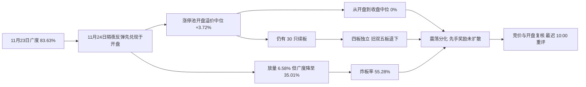

# 2026年11月25日 · 风格研判

> 盘前研究，A股事实截至 **11月24日收盘**。未使用11月25日竞价或盘中行情。数据覆盖部分缺失，风格判断置信度 **0.67**；该值不是阶段概率，也不参与仓位计算。

## 🧭 一句话结论

**震荡分化型：市场仍奖励先手和少数晋级，不奖励普遍追价；研究仓位上限建议 35%，开盘复核。**

11月24日全A上涨面从前一日的83.63%回落到35.01%，尽管沪深成交额增了6.58%，收涨的宽基没有带回多数个股。涨停池仍有隔日正反馈，优势却多在开盘前形成；此后持有到收盘的中位收益为零，双五板都收跌，唯一四板尚未证实带动。另一方面，30只续板、仅两只跌停，不支持市场奖励全面消失，仍有选择性的研究机会。11月25日的情绪首选退潮、备选降温；35%的市场研究上限仅适用于盘前至开盘复核，不以阶段或缺数定仓。账户硬限制不变，也不据此授予买权。

## 📊 广度先降，成交额却放大

11月23日有 `4,658/5,570` 只上涨，24日只剩 `1,952/5,576` 只，涨幅中位数由 `+2.41%` 转为 `−0.67%`。沪深成交额反而增至 `16,548.62亿元`，比前日多 `6.58%`。上证收涨 `0.27%`、上证50涨 `0.45%`，中证500和中证1000均小跌；创业板指高开约 `3.88%`、收跌 `0.05%`。也就是说，放量发生在更窄的上涨面里，高开没有转化为持续买盘。另一方面，涨超5%的仍有 `254` 只，跌超5%的 `44` 只，收盘跌停 `2` 只：亏损面变宽，但极端亏损没有同步扩散，因此不能把全天判作全面崩溃。

| 同口径收盘证据 | 11月23日 | 11月24日 |
|---|---:|---:|
| 全A上涨 / 下跌 / 持平 | 4,658 / 783 / 129 | 1,952 / 3,498 / 126 |
| 上涨占比 | 83.63% | 35.01% |
| 沪深成交额（亿元） | 15,526.63 | 16,548.62 |
| 封涨停 / 封跌停 / 触涨停未封 | 146 / 3 / 24 | 55 / 2 / 68 |
| 炸板率：未封 ÷（封板＋未封） | 14.12% | 55.28% |
| 最高连板及梯队（剔除ST等） | 5板2只、3板1只、2板13只 | 4板1只、3板4只、2板25只 |

11月23日的 `146` 只封板到24日全数匹配到日线。其开盘溢价中位 `+3.72%`，收盘对前收中位 `+3.26%`，`109` 只收红、`30` 只续板；但按每只从开盘持有至收盘计算，中位收益是 `0.00%`，且有 `8` 只跌超9%。前日首板有 `25/130` 晋级，前日双五板则无一晋级、均收绿，平均收跌 `2.07%`。唯一四板在 `09:25` 封住后未开；`09:35` 前首次封板且最终封住的 `28` 只中，仅 `5` 只是首板。它证明最高层仍有承接，却不足以证明它带出了新的买盘梯队。前日炸板池 `24` 只中 13 只收红，但从开盘到收盘的中位收益为 `−0.64%`，也不支持把弱转强当成普遍机会。

- **大资金意图**: 指数抗跌与早盘接力集中，更像资金在少量强势方向承接、同时兑现普涨留下的溢价。日线不能识别持有人和对手方，也不能把个别机构公开看多当成全市场增配。
- **为什么走强**: 上一日大跌后的普涨给了先手较厚的价格缓冲，海外反弹消息也在24日开盘前可见；实际结果是次日先高开，再失去广度。低位梯队仍有晋级，旧最高层失守。筹码归属未核，不能从成交额推断谁在买卖。
- **逻辑够不够硬**: 广度由 Tushare 和 xTick 交叉验证，涨停池有完整收益样本，足以判“接力存在但未扩散”；未证实普遍接力要先看封板后的真实带动。xTick 同日为 `64/4/73`，其 `zbl=15.23%` 分母未核、不可和 Tushare `68/123` 混算。本文另按炸板纪律标记 **情绪=震荡**，它是**炸板风险标记，不是情绪阶段**。

## 🧩 30个交易日的风格背景与外盘

统一取 `10月14日至11月24日` 的30个交易日，对22个同花顺风格代理和20只 ETF 逐日对齐，以 `1−Pearson相关系数` 做平均连接层次聚类，切为6簇。40条完整序列入簇（20/22、20/20）；两个风格代理分别缺5日、15日，不作插值。六簇规模为 `33、2、2、1、1、1`。最大的33成员簇内部平均相关 `0.69`，30日簇均复合收益 `−15.00%`，24日均涨 `0.75%`，其中23个上涨；其余七个样本仅三个上涨。全样本当天26个上涨，其中风格代理15个、ETF 11个，但ETF平均涨跌 `−0.04%`。样本上涨占比65%高于全A的35%，说明有限代理和个股赚钱面不能互相替代；聚类反映共振，不是六条主线，更不是配仓依据。匿名概念计数按技能旧代理为“三主线以上”（19行非ST且计数不低于8），成分可能重叠，未确认独立主线数，由R2判断。

11月24日美股本地晚盘快照为纳指 `−1.48%`、标普 `−0.50%`、道指 `+0.85%`，05:00收盘快讯方向相同、点位口径略异；恒指 `−0.73%`，日经225 `+3.91%`，韩国综合 `+6.32%` 仅作日历未独立核验的报价。美股并非同向避险，但前一晚开盘催化之后的压力又回到了成长一侧。04:09的快讯称多家地方联储曾建议上调贴现率，讲的是10月会议，不是当夜宣布加息；缺少消息前后匹配的价格和成交量，不能把指数下跌归因于该快讯。美股个股日线滞后一日，不用来验证隔夜事件；未核到足以改变判断的发布后新价量证据。

约一月的21个有效观测显示，境内连续黄金、铜、原油的收盘代理分别变动 `−9.61%`、`−14.74%`、`−22.16%`；离岸美元兑人民币 `+0.23%`，美债10年期 `−8bp`，汇债日线均截至11月23日。铜油下跌对需求偏弱是提示，但供给扰动和时点差尚未排除；利率、黄金和汇率也未共同确认降息或广泛避险，故软着陆、降息预期、衰退三档**均未确认**。该背景不拿来压缩仓位或推板块。

## 🌡️ 情绪事实与目标日的两种剧本

本轮原生基线 `lianban_six_v1` 的11月24日事实阶段是 **降温**。连板网公开投影为第1天、`55.1°`，11月25日 `06:00` 抓取，原生绑定 `06:06`，页面版本未知；原生文件带有同源收盘确认引用，但R1未读对应正文，不把公开页升级为收盘版本。其温度与广度回落、旧高位断板一致；少量跌停和正的隔日溢价又说明不宜把“降温”解读为市场奖励全消失。`65/100` 是另一统计量：11月24日的既有四项情绪浓度（涨停家数、连板高度、未回封率、三指数平均涨跌），不改变原生阶段，也不是目标日读数。

原生起始行按修复、升温、高潮、降温、退潮、冰点依次显示 `11%、16%、17%、17%、31%、7%`。原始分母未核，六项相加99%，不重新归一、不补余量。历史同景另看**上证年线下、降温第1天**：分母 `82`，原生快照显示次日去向以 **退潮** 居首（`34%`，另显示高潮 `17%`，精确频数与完整行未核）。上证24日收盘 `3,548.37`，低于250日均线 `3,956.82`，同景条件成立；同景次日上证均值 `+0.12%`、上涨率 `58%` 说的是**指数**，并不是阶段或买入胜率。公开摘录和原生快照同源，只算一份证据。

11月25日**首选退潮，备选降温**，两者都不是观测。保持历史首位，不是因为先验数字大，而是因为24日放量仍失去广度，开盘溢价没继续扩大，旧双五板断掉，来自隔夜的广谱增量也未核到。最强反证是24日只有两只跌停，昨封板池约四分之三仍收红、30只续板，低位梯队未坍塌，隔夜道指还收涨。如果竞价后红盘与承接尚能保持、但上涨面依然扩不开，改判降温；如果开盘成交有效、红盘与昨板溢价共同改善、封板后的同向跟随明显增加，再重评修复。若只是指数高开、未回封仍多且跌停或重跌扩散，则首选成立的证据更强。不报未经校准的数值后验。

## ⚖️ 研究建议及反证窗口

**35%是盘前市场研究上限，不是实际仓位、初始投入或账户额度。** 低于常规扩散行情的理由是：涨幅集中到少数，放量未换宽度，盘中追价中位不赚钱，旧高位失守而新最高层带动未确认。不提市场性零仓，是因为同一收盘仍保有可观的隔日正反馈、续板和低位承接，且跌停少。这个判断不由30日窗口、情绪分、情绪阶段或数据源状态折算。11月25日 `09:25` 先核竞价，开盘首次取得可比广度、昨板反馈、封板承接和梯队数据即重评，最迟 `10:00` 失效；反证不足不上调，亏损外溢则收紧或另立有限窗口的零建议。D1一次统一定预算。账户有效余额与硬预算在本阶段未核，不把未知抬成额度；已有停买、硬上限、T+1、人工确认、逐票硬否决与执行保护原样生效。

## 数据源审计

| 源 | 日期 | 状态 | 备注 |
|---|---|:---:|---|
| Tushare 日线、宽基、涨跌停、梯队、涨跌停价 | 2026-11-24 | 🟢 | 5,576 只有效日线；隔日封板池 146/146；11月25日交易日已核 |
| xTick 行情与情绪聚合 | 2026-11-24 | 🟢 | 广度完全一致，沪深成交额微差；板池独立保留 |
| Tushare 同花顺风格 / ETF | 2026-11-24 | 🟡 | 42条尝试、40条纳入；30日、6簇 |
| 外盘快照 / 商品与利汇代理 | 2026-11-24 | 🟡 | 美股指数用当日快照，日经由指数接口补核，个股与利汇日线滞后，商品为境内代理 |
| 取阅 RSS 公众号 | 2026-11-24 | 🟢 | 94条中筛读盘前催化、盘后复盘和配置观点；乐观意见不等于实盘资金 |
| 五群本地文本 | 2026-11-24 | 🟡 | 397条；剔除本人发言与媒体占位，重点群昨夜有效方向长文未核；昨早分歧预判仅作定性对照 |
| 快讯 / 重大新闻摘要 | 2026-11-25 | 🟡 | 筛读隔夜增量，收盘报道和利率纪要有时点；无匹配的发布后价量反应 |
| 图像 OCR | 2026-11-25 | 🔴 | 批次清单载明67条未成功识别，未消费内容 |
| 批次清单 / 数据源健康 | 2026-11-25 | 🟡 | 读本轮健康报告；局部探针失败不等于本轮行情不可用或停买 |
| 原生情绪快照 / 连板网公开片段 | 2026-11-24 | 🟡 | qingxu仅作全局情绪；阶段版本未知、目标日盘中缺、精确转移未核；不重复加权 |

## 🔗 与其他 R/D/E 的关系

本阶段引用同批 `emotion_cycle.json` 和绑定的专题证据，不读主线/个股正文、不产候选。R2可接收市场风格和奖励条件，R3可引用事实日浓度，D1按有效窗口及新证据独立决策，E1可对照开盘后的真实表现。无需另读来源文件来解释本轮R1的专题裁决。

## Sub-Agent 元数据

- Skill：`analyze_style_v1@1.2`
- 机读文件：`data/research/20261125/R1_style.json`
- 启动至落盘准备：525 秒；实际用量未计量，不按0处理。
- Model：`gpt-6.2-sol`
