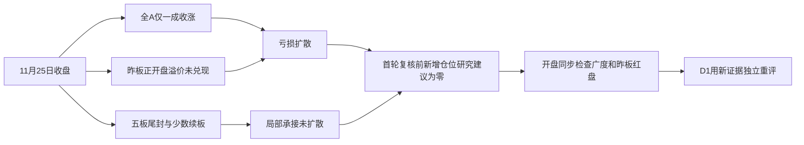

# 2026年11月26日 · 风格研判

> **基准**：11月25日收盘，11月26日盘前判断。数据部分降级，置信度 0.70；目标日盘中尚未观测。

## 🧭 一句话结论

**震荡分化型，亏钱效应占优；只奖励少数存量接力，盘前至早盘复核前，新增仓位研究建议0%。**

## 📉 广度与市场奖励

前一日还有 `35.01%` 个股收涨，11月25日只剩 `586/5,573（10.51%）`。`4,926` 只下跌，其中 `1,860` 只跌超5%，而涨超5%的仅 `108` 只。沪深成交约 `13,829亿元`，缩量 `16.43%`；上证、深成、创业板分别跌 `2.03%`、`3.24%`、`4.19%`，中证1000跌 `4.44%`。上证最后30分钟再跌 `0.43%`。两源广度一致，说明这不是少数权重股拖累指数，也没有看到放量托住多数弱股。

11月24日涨停池在25日开盘仍有 `+2.05%` 的平均溢价，但中位只有 `+0.03%`；到收盘只剩 `19/55` 收红、`14/55` 续板，收盘对前收的中位数转为 `−4.47%`。从开盘持到收盘的中位数是 `−4.67%`；前一日炸板池对前收的中位数为 `−6.13%`。市场奖励的是少数能持续封住、已有先手的接力，不是随高开追价，也不是普遍的低位反弹。这里的回报是等权样本反馈，不等于实际可成交收益。

最有力的反证是：仍有 `51` 个终封、`37` 个首板，未回封率由 `55.28%` 降至 `30/81（37.04%）`，另有 `23` 个曾开板后回封。可盘中触板样本数也从123降到81，跌停则从2增至43。现有二至五板分别为 `5/6/2/1`，四进五仅一例；一进二 `5/25`、二进三 `6/25`，龙头高度没有转化成宽广的接力。唯一五板直到 `14:54` 才首封，而37只最终首板已有35只在午前首封，不能反推是它带出了早盘扩散。五类最接近**震荡分化型**，但分化明显向下；连板情绪、主线扩散、防御观望均不合事实，崩溃退潮型所需的50%炸板线也未触及。情绪浓度 `59` 只描述既有规则下的11月25日，不能冲淡实际亏钱效应。匿名榜单20条中11条达既有数量代理标准，因成分重叠，不等于确认三条独立主线。

- **大资金意图**: 缩量下宽基与多数股票同跌，只能推断广泛承接不足、资金选择少数存量强势，不从行情反推具体机构在买或卖。
- **为什么走强**: 局部封板有真实续接，尤其少数高位；但低阶晋级少、最高板尾封、昨板普遍回吐，强的是局部而不是整条链。
- **逻辑够不够硬**: 广度双源一致、涨停池匹配完整；两家板池计数不同，结论不靠合并计数。只有同步广度、溢价兑现和梯队承接能推翻当前判断。

## 🧩 30日聚类与隔夜外盘

10月15日至11月25日，共30个交易日。22个风格代理与20只ETF逐条对齐，两个风格代理分别只有24和14个有效日，两者均缺11月25日，不补值；其余40条用 Pearson 相关距离与平均链接切成6簇。20条风格代理 `1涨19跌`，20只ETF `1涨18跌1平`。最大簇的33条序列无一上涨，当日等权均值 `−3.56%`；其余簇较小，两个孤立簇当日一个上涨、一个走平，不足以翻转广度。聚类只呈现风格与ETF同时走弱的背景，不是调仓刻度。

| 匿名簇 | 样本 | 11月25日等权均值 | 30日复合收益的样本均值 |
|---|---:|---:|---:|
| C1 | 33 | −3.56% | −16.31% |
| C2 | 1 | +1.47% | −14.72% |
| C3 | 2 | −0.40% | −0.48% |
| C4 | 1 | −1.45% | −7.67% |
| C5 | 2 | −0.29% | −3.45% |
| C6 | 1 | 0.00% | +6.20% |

亚洲上一场恒指跌 `1.14%`、日经跌 `2.78%`；韩国综合报跌 `6.16%`，交易日历未独立核验，不给同等权重。美股11月25日收盘道指 `+0.33%`、标普 `−0.25%`、纳指 `−0.62%`；费城指数跌 `0.65%` 仅有快讯旁证。这组收盘反映的是跌幅收窄而非普涨。盘后快讯称总体PCE环比 `+0.3%` 符合预期，核心同比报道彼此冲突，未核官方原件；数据之后标普和纳指回升但未翻红，不能把这段报价全归因于PCE，也未核同窗成交量或足以改变市场剧本的发布后财报反应。约一月直接期货结算价金、铜、油分别约 `−10.84%/−17.03%/−21.87%`，只作增长压力背景，不能据此下衰退结论；离岸汇率和美债10年期日序列只到11月24日。盘后公众号摘要与普跌、缩量相符；重点群只核到匿名见底判断，不足以作重点KOL方向共识。

## 🌡 情绪基线与反向剧本

同批原生阶段只有11月25日的**冰点**。专题仅核公开正文 `3,600/5,637` 字的前缀，网页显示 `5.0°`、连续第6天；11月26日06:00抓取，公开页版次仍未知，06:06校验的绑定基线不等于目标日盘中。全局先验显示修复 `53%`、冰点 `26%`、高潮 `12%`、退潮 `4%`、升温 `2%`、降温缺项；分母未核，显示和为97%，不补余量。另看连续≥4天同景，绑定分母为 `5`，显示首位是冰点 `60%`，次列高潮 `20%`；页面的年线下方同景提示是次日指数均值 `+0.10%`、上涨率 `40%`，不是个股赔率。上证收于 `3,476.47`，低于同口径250日均值 `3,954.60`。两组页面信息同源，不相加。

11月26日首选**冰点**，备选**修复**。暂不跟宽样本首位，是因为昨板开盘溢价被收盘反转、跌停迅速增加且高标没有扩散，隔夜也未形成广泛反转。最强反证仍是宽样本修复居首、未回封率下降、14只续板和外盘跌幅收窄。开盘若同窗广度和昨涨停池红盘率达到既有反向检测参考（`55%/60%`），且溢价能兑现、未回封压力下降、低位对高位有跟随，则重评修复；指数独自翻红或单个高位再封不足以改判。阶段不授买权、不定仓。

## 🛡 仓位范围与失效条件

**新增仓位研究上限为0%，仅从本报告实际生成至开盘首次有效复核，最迟当日10:00失效。** 这是本轮市场回报不足以补偿新增风险的判断，不是账户有效预算为零，不是减持、撤单、清池或全天停买指令。届时证据仍缺，不自动把这个窗口延长；由D1结合新证据统一核定预算，并原样遵守真实用户与账户硬限制、T+1、人工确认及逐票否决。R1不输出板块或个股，也不写交易计划。

## 数据源审计

| 源 | 日期 | 状态 | 备注 |
|---|---|:---:|---|
| tushare_market | 2026-11-25 | 🟢 | 全A日线，匿名汇总；尾段30分钟补核。 |
| xtick_market | 2026-11-25 | 🟡 | 全A广度一致；zbl分母未知，不置换主口径。 |
| tushare_ths_etf | 2026-11-25 | 🟡 | 请求42；两条风格完整序列缺失，余下40条入6簇。 |
| overseas_snapshot | 2026-11-25 | 🟡 | 美股三指数回退报价与新闻交叉；港股指数可用，韩股日历未核；个股滞后。 |
| tushare_global_macro | 2026-11-25 | 🟡 | 外盘直连补日本；美股直到24日、美元指数月度不可核；独立结算期货、汇率和收益率附各自日期。 |
| wechat_official_20 | 2026-11-25 | 🟢 | 筛盘后标题/摘要；同RSS兼容投影，不重复计数，非逐篇通读。 |
| wechat_cli_5groups | 2026-11-25 | 🟡 | 筛重点群夜间文字；22:26见匿名见底判断，未核重点KOL本人市场方向长文，不赋共识。 |
| news_cls | 2026-11-26 | 🟢 | 筛盘后与美股收盘宏观快讯；核心PCE同比冲突、反应成交量缺。 |
| news_major | 2026-11-26 | 🟡 | 筛夜间相关摘要，未核到有独立增量能翻转全市场排序的硬催化。 |
| wechat_image_ocr | 2026-11-26 | 🔴 | 据清单67条均未识别，不宣称读图。 |
| fetch_manifest | 2026-11-26 | 🟢 | 批次覆盖与来源健康，仅影响置信度。 |
| mcp_health | 2026-11-26 | 🟢 | 探针为局部缺证，不是市场证据。 |
| iwencai | 2026-11-25 | 🔴 | 无已配置凭证，已由Tushare与xTick完成客观主证。 |
| emotion_cycle | 2026-11-25 | 🟡 | 同批原生基线，仅最近观测；无目标日盘中。 |
| lianban:qingxu | 2026-11-25 | 🟡 | 只采有限传输前缀，不冒充全文，和原生基线同源。 |

本阶段使用同批原生情绪基线供 R2/D1 消费；R2 独立验证主线，D1 统一核定预算。专题索引及裁决见机读件；外部交付结果与用量仍待计量，不以未知作零。

## 生成信息

`analyze_style_v1@1.2` · `data/research/20261126/R1_style.json` · 从流水线启动至生成约 434 秒。
