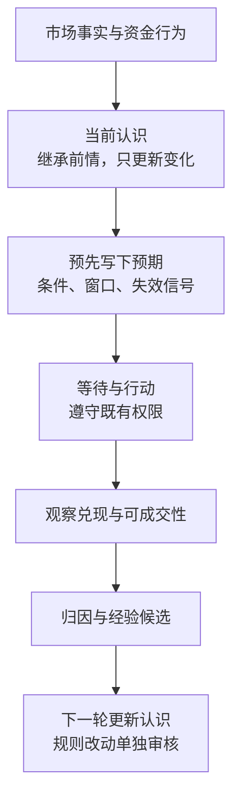
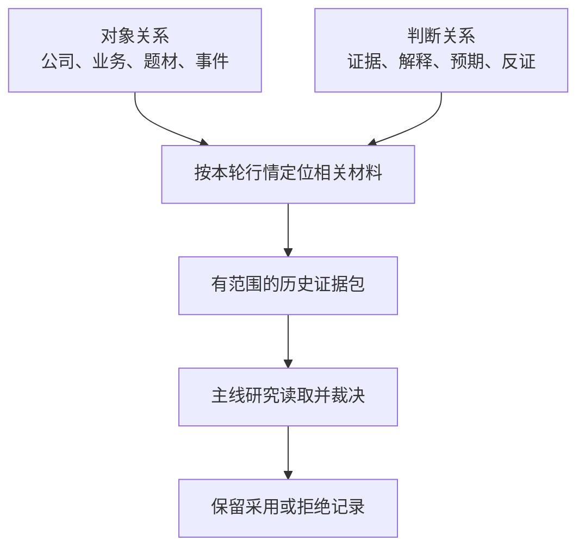
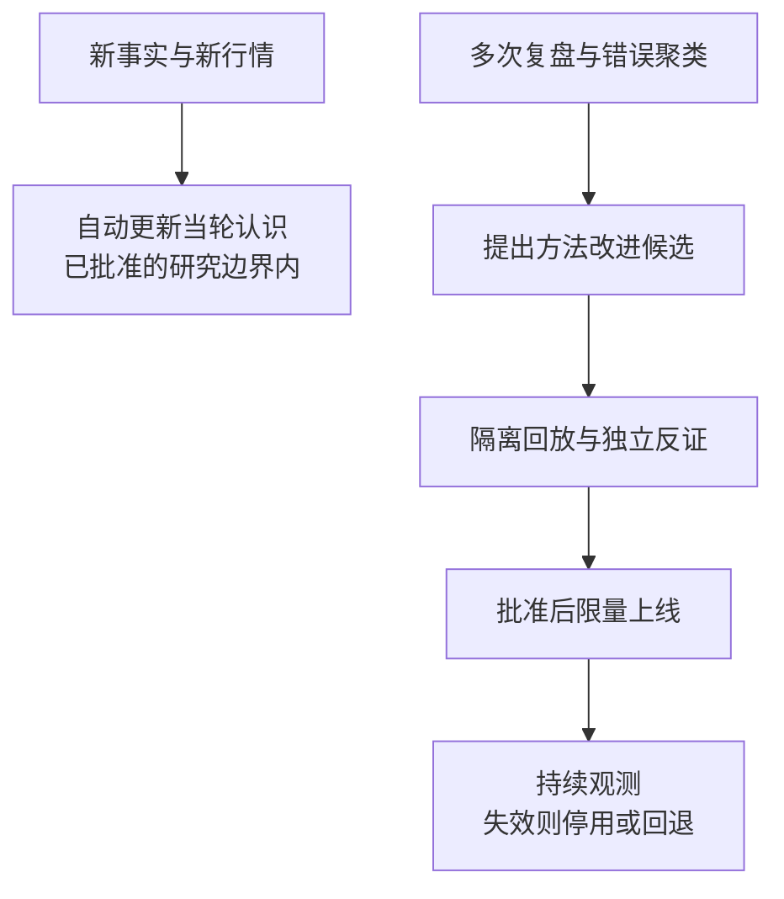
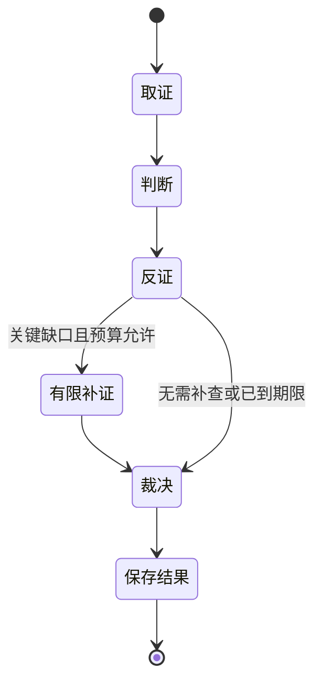

# 市场反馈驱动的认知闭环与分期施工方案

> 版本：审阅稿 v0.4 · 2026-10-26（CST）。v0.2完成一次独立审阅及主控修订；v0.3加入跨预案采用、六只执行候选、双池价位表和可复算评分；v0.4按用户纠偏明确“市场—板块效应—个股地位—买卖机会”，补齐板块独立判断、带动／跟随关系与独立行情分类。新增部分为主控设计补充，未另做独立审阅；仍待用户审核。这是实施前的设计与验收合同，不是功能已上线声明。
>
> 模型迁移为独立已批准事项；本方案涉及的代码、技能、读取权限、预算参数、路径及自动晋级政策，尚未获实施批准。主对话 SOUL、交易权限与既有退出纪律保持不变。旧架构文档原文保留。

## 先读这一页

**目标：少重复推理，让已有研究在正确时间被唤醒；用市场反馈更新认识，而不是靠用户每天纠正选票。**

**最终交付落在选票与买卖安排上**：不同预案／研究的结论应改变具体候选、优先级、机会条件和失效条件，而非仅汇总成另一篇文章。执行候选以最多六只合格标的为目标，执行池与观察池均交逐票价位和机会速查表；有来源、可复算的评分辅助比较，但不能替代买点和交易资格。详见§4.1—4.6；此处是目标规格，未修改生产配置。

**判断对象不能缩成个股：先看市场正在奖励什么，再看资金是否形成板块合力、赚钱效应能否扩散与延续，再判断个股在其中的地位和买点。** 板块是独立研究与反馈对象，不是个股分数里可有可无的小加分项；个股强不等于板块强，板块强不等于其中每只票都值得做。龙头带动、板块托举和独立行情需分别核验。

市场是检验判断的外部参照，不是每一天都给出无噪声答案的老师。系统要学的是：在什么市场条件下，哪类行为得到可参与、可退出的回报，原先的解释哪里成立、哪里失效。不是看到涨了就补理由，也不是把昨日赢家永久写成规则。

用户负责目标、软件架构建议、资源与权限边界、进化发布审核；研究系统负责发现、判断、跟踪、反证与提出改进；确定性程序负责校验、限额、版本、权限及执行。用户的临时观点是可检验假设，不默认成为市场真相；现有硬边界不会因用户减少选票干预而自动解除。

**本轮不建设新平台，不新增研究角色，不更换 OpenViking，不重做 LLM Wiki，不用更多讨论替代更好的消费。**

阅读顺序：§1边界 → §2认知链 → §3市场学习 → §5防循环 → §7施工与周期 → §8验收 → §10签核。

## 1. 现状与必须纠正的认识

### 1.1 可核验的当前事实

本轮迁移盘点时点为2026-10-26 19:31 CST；主模型最小验收到19:48 CST：

- Hermes实际发现并有配置的角色为 default、canghai-fetch、canghai-research、canghai-plan、canghai-review、hermes-visitors。共6个，不按历史记录或任务前缀计数。
- 各任务库合计37条任务，其中15条直接启动模型的任务已经固定为 `openai-codex / gpt-6.1-sol`。本轮未改任务定义。
- 主模型迁移前，default保存的是MiniMax，其他5个保存的是Agent Plan的DeepSeek。外层任务固定模型不替代脚本内部角色的默认模型。
- 经用户对精确差异签核，6个保存默认值已切到 `openai-codex / gpt-6.1-sol`；逐角色不带模型覆盖参数的新会话均通过真实模型与一次terminal工具测试。完整生产链、并发容量、竞价期限、每日持续交付尚未因此验收。
- `scripts/research/run_research_shell.sh:97-149` 有有限重试，但多类失败汇入同一个整段重试分支。现有实现不能据此称为无限循环，也不能视为具备跨重试、跨子任务的总用量控制。
- `scripts/research/build_research_summary.py:85-112` 的辅助输入适配仍为主动选择且待授权；列出候选路径不等于真实读取、采用或改善决策。
- 现有Wiki已存在，其 `schema.md` 已包含来源和假设演化结构。当前需求不是再建一套Wiki，而是明确消费时点、来源效力和更新责任。

### 1.2 不沿用的历史结论

旧技能和召回材料中包含历史角色数量、已退役信息源、固定阶段到打法的映射、静态股票过滤阈值，以及对Agent能力和计费的绝对断言。它们只是有日期的旧材料，不能覆盖当前用户定义与SOUL。

尤其不能采用：

- “Agent比用户更懂市场”作为已证事实；需要同口径、样本外结果。
- “市场上涨说明原叙事正确”，或“资金先动说明存在特定内幕原因”。
- “发生过亏损所以应立刻禁止某种打法”。
- “记忆搜到了建议，所以用户已经批准该建议”。
- “额度更大，所以不再需要预算与停止条件”。
- 以维护表面合规为由隐去原始来源、首次获知时间或关联证据。审计记录必须真实完整。

这类冲突列入待审整改，不在本轮暗改技能、身份或权限。

### 1.3 不动的业务边界

低吸、半路、抄底沿用用户原定义；不把低吸改写成大跌接飞刀。先看市场奖励什么，再定打法；情绪阶段提供背景，不固定映射打法。流通市值硬线、短线炸板破均线退出、主线建仓退出边界及既有执行授权不因学习系统上线而放宽。禁止开仓不等于停止研究或清空观察池。

## 2. 认知闭环：把文章变成可追踪的判断

### 2.1 最小单元不是文章，也不是永久标签

建议以“某个对象在某轮行情、某个时间窗口里的判断”作为单元。最少记录：

- 对象：稳定题材／公司，以及这轮行情的标识；历史龙头不等于本轮龙头。
- 判断摘要：系统当前相信什么，哪些只是推测。
- 来源：原始材料、来源家族、派生关系、版本指纹；同源转述不重复增加可信度。
- 时间：事件发生、公开、系统首次获知、行情观测、判断生成、适用区间与检验截止时间。
- 证据：支持与反对材料；同一证据可以被不同解释使用，不能强行消灭分歧。
- 预期：后续应看到什么、什么情况推翻或削弱它；不能只写“看好”。
- 处置：采用、拒绝、观察、待证，及理由；不得强迫每条研究变成交易。
- 后续观测：支持、削弱、推翻、到期未验证或数据不足；保留旧版本，不改写原预测。

这里保存的是**可审计的判断摘要与依据**，不是每个模型的完整内部思考过程。没有必要把所有中间文本再送进另一轮模型压缩。

**时间约束作用于内容版本，而非仅作用于事件日期。** 原文及每层派生材料都要锁定当时系统实际可用的版本与首次可用时间；旧事件的盘后新摘要、补写复盘、后改Wiki不能混进旧时点。只要派生链中有无法确认在截止点前可用的内容，该版本就不得用于历史效果确认。无法重建当时版本时标为不可回放，不用现在重写的摘要伪造历史输入。

### 2.2 两种关系分开存，先不装新图数据库

对象关系回答“这是谁、和谁有关”；判断关系回答“为什么这么判断、后来被什么改变”。产业关联不自动等于短线资金关联；母题材资金数据不能冒充子分支独立证据。

四条不同步的时间线必须保留：事实变化、消息传播、价格响应、资金及筹码观测。先后关系本身不是因果。横盘、下跌、首次进榜不能自动翻译成吸筹、洗盘、新建仓。

### 2.3 已有产品的分工

**原始材料与结构化研究**：事实和来源底稿，优先直接复用，不走“JSON→文章→模型重新抽回JSON”的重复路径。

**OpenViking**：按对象、问题、时间和适用范围定位历史材料；检索结果必须再过时间与来源校验，不把召回文本当指令。

**LLM Wiki**：为人浏览、关系定位和专题理解服务。是派生视图，不是第二套事实权威；不要求所有研究角色每日全读，也不全量重建。

**活跃判断**：属于现有研究产物的有限状态，不再成立一个永久讨论Agent。只保留当前仍有关的判断及待验证问题。

**错题与经验候选**：属于现有复盘链；用于防复发与下一轮提示。经验候选不自动成为交易硬规则或技能更新。

**现有报告**：继续交付。新增信息优先附着在已有契约或现有汇总里；确需新增文件、字段和路径，先单独给兼容及签核差异。

## 3. 以市场为老师，但不模仿噪声

### 3.1 每轮先回答市场在奖励什么

研究同时观察全市场广度、涨停后的溢价、连板梯队与晋级、炸板后的承接、题材内扩散与淘汰、辨识度，以及不同入场方式的后续可参与回报。不是把情绪阶段名称直接套进固定操作表。

观察粒度需区分全市场、题材、个股；不同持筹状态和获利／被套压力只在有证据时解释，不凭想象指定“同一批资金从A去了B”。主线研究把不同机会的相对表现交给决策，系统在既有批准边界内选择或等待。

### 3.2 预先登记，再看结果

每次判断先冻结信息截止点、条件和预期窗口，再追踪后续。盘后复盘至少分开：

1. **事实错**：源数据、字段或时点错。
2. **解释错**：材料没错，但推导不成立或替代解释更强。
3. **阶段／对象错**：题材识别正确，却选错本轮核心或介入窗口。
4. **决策错**：证据已到，仍做了不匹配的选择。
5. **执行错**：计划合理，但交易未按条件执行或不可成交。
6. **证据不足**：不能检验，不能硬判成功或失败。

既看选择的票，也看拒绝、观察和漏纳入对象。板块三问保留：有没有漏纳入、有没有选错、有没有做对。机会损失纳入评估，但不把所有事后上涨都追认为事前应买。

**检验总体事前冻结。** 运行时保存候选集合、选中／拒绝／观察状态、市场覆盖规则、方法版本及预期检验窗口；两组对照采用相同覆盖基准。漏选按事前确定的市场覆盖规则识别，再核当时可得信息与可参与性，不能从事后赢家反推一份“本应选中”名单。对象级检验覆盖率、可交易性分组、任务级空池率与有效交付率分别使用各自分母；数据未知、到期未验证、不可成交单列，不混成一个胜率。

### 3.3 学习指标分层，不能只追胜率

- 认知：关键前情召回、来源独立性、预测校准、反证识别、同类错误复发。
- 决策：在相同信息截止点、候选覆盖与允许动作下，哪些选择相对原方法更好。
- 可交易性：能否买到、T+1后能否卖出，停牌、封板、滑点、费用与可用盘口缺失如何处理。
- 运行：按时交付、缺失披露、读取及采用留痕、预算与停止边界。

用户胜率口径保留：竞价买入后，次日开盘、尾盘、高点各自计算盈利情况。**三种卖出场景分别报告，不择优合并成真实胜率；次日高点是理想机会场景，不等于可实现成交。** 无成交记录时报告价格场景而非实盘收益；缺关键数据进入未检验分母说明，不静默丢弃。

策略比较要有同期基线与风格分层，不把整个市场的上涨归功于系统；不要求事后重写历史信号。先做时间顺序留出，开发样本与确认样本隔离；新模型带来的差异与历史复用带来的差异分开比较。

历史回放仍可能受到模型自身已知历史结果的污染，固定同一模型不能消除这一点。历史回放用于工程正确性、探索与候选方法筛查；对预测改善的确认，以预先登记、不可事后改写的前瞻观察为依据。不知道模型训练信息边界时如实列出限制，不把历史回测当作无泄漏的预测证据。

### 3.4 两种进化速度

**快循环**更新当前认识：新证据出现后可以改判，不必用户每天指定股票；每次运行有期限，结果供下一次调用使用。

**慢循环**更新方法：跨样本评估后形成技能／规则差异，经过审核、有限上线与回退验证。不能因为当天亏损或一次大涨自动重写技能。风险限额、身份、配置、权限始终单独签核；所谓自进化不是自授权。

短期不新增在线训练模型。现有API模型参数不会因写了几篇复盘自动训练；本期“学习”指可验证的状态更新、经验检索、假设修正和受控方法迭代。

### 3.5 自动改判与方法发布的字段边界

下表是待实施的权限契约，不是现有字段已经具备强制校验的声明。确切schema和所有者须随实现差异批准。

| 内容 | 允许的自动更新 | 不允许通过记忆或提示词偷偷生效 |
|---|---|---|
| 对象判断、证据、当轮置信度、失效状态 | 研究所有者依据新证据追加版本，并保留原判断 | 覆盖历史预期、改变全局选股规则或执行权限 |
| 经验候选与错误聚类 | 复盘所有者记录为未批准假设，给出处境、样本及反例 | 作为强制过滤器、默认排序规则、默认阈值或行动许可 |
| 正式方法版本、筛选算法、固定阈值、技能 | 形成独立差异与测试建议 | 未经方法发布审批直接启用；即使不改技能文件也不例外 |
| 风险限额、身份、写权限、交易授权 | 仅提出变更建议 | 由检索结果、经验晋级或模型自报扩大权限 |

经验可以作为待检验解释影响研究问题，不能作为必须服从的指令。凡改变默认选择算法、阈值或执行行为的内容，不论载体是代码、技能、Wiki还是记忆，都走同一审批边界。检索输入显式分离来源事实、历史判断、未批准经验与已批准方法；增加“未批准规则经检索注入”拒绝夹具。

## 4. 第一条接线：只接一个消费者

选择“历史主线判断＋相关消息／资金证据＋反证＋复盘 → 新一轮主线研究”。理由是已有材料较集中，且可沿现有链路影响画像和决策，无需同时扩大所有角色的权限。

**建议原型流程**：

1. 研究开始前，程序根据批准的来源政策、信息截止点与版本，选择有限历史材料。
2. 从已有结构化结果构建短证据包；必要时才对缺少结构的原文做一次增量抽取。
3. 先定位主题与未解决问题，再取相关证据；至少保留反对证据和来源缺口，不以相似度最高的乐观结论占满上下文。
4. 主线研究对每条相关历史判断给出继承、更新、拒绝或待证。无需为了体现价值强制改变当天判断。
5. 独立反证检查同源重复、时间污染、母子口径错配、过期规则与未经支持的因果解释。
6. 记录输入交付、实际工具读取、裁决采用三个不同层次；“引用了”不等于“用了”，“用了”不等于“用对了”。

**与既有七类辅助输入提案的关系**：旧提案仍未批准，不能整体套用。先比较来源重合与权限冲突，再提交本期最小差异；不在决策角色增加另一套宽目录读取，也不以新证据包绕过原输入校验。

**低频材料按触发使用**：股性与题材锚作为背景，遇成分／辨识度变化再评估更新；红利与成长扩池只在相关风格或研究问题出现时唤醒。月更不等于失效，日更不等于有用；更新频率和消费频率分别登记。

### 4.1 不同预案与研究怎样相互利用

不让各预案互相全文抄写或循环征求意见。复用已生成的结构化结论，围绕同一“题材本轮行情／个股／交易场景”关联，保留来源版本、适用期限、支持与反对证据；由现有主线研究和计划端按批准链路消费，不新增常驻综合Agent。

关联分两层：板块层先汇合消息、资金、梯队、强弱扩散及历史反馈，形成共同场景；个股层继承这个有版本的场景，再判断带动、承接、补涨、跟随或独立性。公共板块结论只维护一份，逐票引用，不为每只票重复推理。同一板块有共同失效条件，不将它拆成若干彼此独立的个股风险。

- **市场风格与赚钱效应**：回答市场正在奖励什么，影响本轮机会类别和适用条件；情绪标签不直接映射固定打法。
- **主线、消息、资金、股性与辨识度**：合并同一候选的证据，影响“选谁、为什么选、在什么场景优先”；同源转载及同一资金事实不能重复当作独立支持。
- **个股画像与反证**：明确关键假设、兑现节奏、筹码压力和冲突，影响入池／候补／拒绝以及买点失效条件。产业逻辑不是短线退出规则的替代品。
- **专题池与周度结论**：股性、题材锚、红利／成长等只在相关风格或事件触发时提供候选与背景，不将不同持有周期的结论直接拼成当天买入理由。
- **盘前主剧本与反向剧本**：标明互斥、替代和可共存关系。反向剧本的标的只在其资金／价格条件出现后激活，不能把相互矛盾的剧本简单平均成“都可以买”。
- **竞价与午盘修订**：绑定原计划版本，逐票保留原预期、实际观测、改后动作和原因；更新条件与顺序，而非另生成互不相认的名单。进入自动执行仍以实际修订消费者接线和授权验收为准。
- **日复盘与滚动持仓复盘**：分清选错、漏选、无买点、入场错、退出错、不可成交和未检验；将未兑现假设送回下一轮对应研究。不能因盘后上涨而补写盘前支持理由。

逐票必须能回答：“本轮采用了哪条旧判断／哪个预案的结论；它改变了候选、顺序、买点还是风险；为什么继承或推翻”。没有相关新增证据时允许维持判断，不能为了证明接线有用强制改票。首条历史复用仍仅接主线研究，向计划和盘中修订扩展按批验收，不把目标图当作已实现全链互通。

#### 板块效应与个股地位的联合判断

以下为依据用户指定游资资料整理的待实施口径，不将书中案例或统计数字当成当下有效阈值。

**板块层**需独立回答：是否只有孤立强股，还是核心与跟随出现扩散；涨停／晋级梯队和炸板反馈如何；参与者是否获得后续溢价而非只见当日冲高；资金是持续承接还是快速轮动；分歧后哪些核心能修复；相对市场是增强还是减弱。板块指数、核心成分、红盘广度、成交参与和资金代理分别呈现，不以单个指标替代结论。概念成分与观测窗口事前固定，注明数据源和时点；必要时检查剔除候选自身后的板块表现，防止单只大权重拉高指数后被误认作群体共振。母题材、子题材及多概念重叠去重，不反向挑上涨成分制造板块强度。

**关系层**区分以下证据状态，角色可随观测改变，不作为永久头衔：

| 角色／状态 | 需要说明的关系证据 |
|---|---|
| 板块带动核心／龙头 | 不只自己涨得高；在上攻、分歧、修复等节点与同题材扩散、承接、跟随赚钱效应存在可观察联系，且市场辨识度与相对强度支持其核心地位 |
| 容量中军／承接核心 | 承载主要成交与资金，影响板块稳定和承接；不因连板高度不高而忽略，也不自动等同情绪龙头 |
| 先锋／潜在龙头 | 率先启动但板块扩散尚待确认；注明确认窗口和失败条件，不提前封为真龙，也不因暂未出现批量板而一刀切漏掉首板机会 |
| 补涨／跟随 | 主要受益于既有板块强度，需说明相对其他跟随者的地位与接力条件；不能把板块的强全部记成个股自身能力 |
| 独立行情／关系未确认 | 暂无充分板块联动证据，或存在公司特定事件、独立资金路径；不冒充板块龙头，也不自动归为庄股或禁止研究 |

“带动”首先是待验证的市场关系判断，不是见到先涨后涨就证明因果；同步上涨也可能来自共同消息或市场反弹。保留事件时序、共同催化和反例，证据不足写待确认。独立行情与板块核心分组评价，不能借一个概念标签领取不存在的板块支持，也不能因不属于当前强板块而从研究中消失。

**行动层**必须传递板块条件：板块共振型买点同时满足个股触发与已登记的板块确认；买入前板块失效则取消该场景，不能只因个股价格触线继续推荐。持有后的板块弱化进入原退出方案，与个股止损及可成交性共同处理，不能以“等板块修复”放宽既有硬止损。龙头与板块分离可能是独立走强，也可能是风险集中，须重新分类，不机械认定“必然穿越”或“板块一弱所有股必卖”。具体执行仍需按既有授权接线。

**复盘层**先回答“板块有没有漏判、板块对了有没有选错角色、板块和个股都对了是否买卖点做错”，再与同板块其他核心、同期市场及原本可知信息对照。板块普涨中的获利不能全记为个股选择能力；用关系和同期对照解释，不把未估计过的超额收益／因果量写成确定数字。

资料锚点：`chzl_kg/投研交易/游资风格/新生代游资核心观点整理.md:135-147`（相对强弱、带动力与交易一致性）、`:215-229`（板块氛围与先锋）、`:309-315`（主线及带动跟随赚钱效应）；同目录`新生代游资交易纪律.md:15-18,28-35`；`炒股养家心法(高清彩色)解密 (菩萨戒子 整理) (z-library.sk, 1lib.sk, z-lib.sk)_可搜索.txt:128-137`（赚钱／亏钱效应、大盘与主流热点、动态判断）。这是本轮指定资料的定向阅读，不声称全文审计。

旧规则冲突提示：本轮加载的`short_line_thinking_v1`仍含固定阶段配仓、静态禁止半路、主线必须政策等因素全齐的旧表述；这些与现行SOUL的动态打法及允许纯情绪题材等约束冲突。本方案不沿用，不借资料复用恢复；技能修订另提差异签核，本轮未改技能。

### 4.2 六只执行候选，与实际持仓数量分离

用户2026-10-26补充需求：执行池希望扩至六只，以减少候选过少而全部没有合适买点的情况。目标定义为**正常允许开仓且合格机会足够时，提供六只执行候选；不足六只如实少给，不用杂毛或不合格标的凑数**。六只是研究交付目标和候选容量，不是每天必须买到的数量，也不保证每天必有可成交机会。

候选容量、实际持仓上限、每日买单数、总仓位与单题材暴露分别管理；本次需求不提高后四项。持仓维护／退出清单不应挤占六只新机会的展示名额，底层兼容方式另给实现差异。尽量覆盖不同成立条件，而不是将同题材、同买点、同时失效的标的换成六个名字；不为分散而强选弱题材。

六只按已确认的板块机会与角色组织，不先取个股总分前六再倒找题材。展示各板块首选、同板块候补及反向场景；不预设固定“每板块几只”，同板块可以有多个候选，但明确替代关系与共同失效风险，不能把多只同题材候选当成多份独立机会。

截至2026-10-26本轮只读核查：`data/user_preferences.yaml:65-69` 已写执行池范围 `[5, 8]`，但 `src/plan/d1_algorithm.py:768-798` 使用持仓上限截断执行池。两者需解耦，不能通过把持仓上限改成六来扩大候选池。这只是发现的一条代码路径，尚不能据此认定每天仅两三只的全部根因；施工时还需核实际生产入口和逐层候选去向。

不足目标时必须分类显示：真实合格机会不足／尚无买点／市场禁止开仓／账户额度不足／数据阻断／生成或筛选异常。禁止开仓仍保留研究、排名和观察；市场判断与链路故障不能混为“今日没机会”。

### 4.3 先逐票解释，再交双池买卖速查表

执行池、观察池及反向剧本均覆盖全部已列标的，不只写前几只。保留自然语言解释，在各池解释后增加可直接比较的汇总表；观察池按可候补、等待条件、仅观察／禁买分组。已有版式上补齐，不再新增另一套生成器或独立模型总结。

逐票之前先给**板块机会总览**：板块／本轮行情、效应与延续状态、核心和梯队、共振／分离证据、主剧本／反向剧本、确认／失效条件、数据时点。逐票表增加“所属板块及角色”“板块条件是否成立”；独立行情单列，不能只显示概念名称而没有关系证据。由同一结构化判断渲染，不另启动模型重写板块摘要。

为避免一张表过宽，按相同股票与场景键输出两张紧邻的速查表；下表是字段契约，不是带虚构行情的交易示例。

| 表 | 必须列出的信息 |
|---|---|
| 机会与买入表 | 优先级、股票、所属池／状态、可复算分及评分时点、机会类型与理由、适用场景／时间窗、触发价、可买区间、最高接受价、资金／量价确认条件、不做条件 |
| 退出与风险表 | 股票及对应买入场景、初始止损价、止损触发依据、分档止盈价及动作、移动止盈条件、失效／取消条件、可卖限制、数据时点与缺口 |

每个不同买入场景独立成行，避免把竞价场景的买入价和另一场景的止损拼在一起。报价必须能追到明确交易日的数据和计算依据，核实际交易价格口径、最小报价单位及有效期限。盘前具体价位加条件；盘中动态均价／移动止盈需给当前数值、更新时间和更新规则，不能拿旧数值冒充实时线。

有硬价位但未满足量价／板块条件，仍不是买点。未取得可靠数据时明确“未计算／数据过期／仅观察”，不填默认价格或零值掩盖缺口。非交易观察对象明确“不适用／不建议开仓”及重新评估条件，不为了填满表格编造推荐买点。卖出安排必须区分触发信号与实际可卖、可成交状态，不能承诺触价必能成交。

观察候补应与执行候选使用同一价位引擎和规则口径，包含完整退出方案，而非只给激活价。结构压力位、规则生成目标与已校准的收益预期必须区分；不能先按固定盈亏比算出目标，再把这个比值当成独立证据给高分。

截至本轮核查，`src/plan/render_markdown.py:213-263` 已有执行池价位表，但观察池表没有完整止盈止损栏；`scripts/plan/render_plan_tables.py:124-147` 的观察块也不能保证完整退出说明。因此这是补齐已有交付链和一致性，不是从零新增表格。

### 4.4 “真实评分”：可复算、可追溯，不伪装胜率

所有池采用同版评分口径；展示**候选质量分、当前机会状态、数据完整度**，不能压成一个没有条件的数字。先检交易资格，再看触发／可参与状态，再在同一适用场景内按质量和风险比较；不同市场场景的分数不直接当作全局强弱。评分高不能覆盖禁买、超价、无买点或仓位限制。

评分采用分层结构：**板块机会评价 → 板块内个股地位／质量评价 → 当前买点与可执行状态**。各层分开解释、保留依据，不能把板块效应缩成固定小权重后让个股技术分抵销板块场景失效；也不能把板块分直接复制给所有成分股。独立行情另列适用场景与证据，不与板块龙头强行按同一个无条件总分排序。需要全池优先级时，显式交代先选择哪个市场／板块场景及原因，再比较该场景内对象；权重和阈值仍待检验与签核。

拟评估维度为辨识度与主线地位、可验证资金确认、当前赚钱效应匹配、买点与退出的可执行性、催化与反证质量；维度定义、去重、权重、阈值和适用范围在实现前单独展示差异并冻结。纯情绪题材不因缺产业逻辑被自动判低分；取其适用证据。不得凭模型印象自由给总分，不把板块分直接充当个股分。

每个分项保存原始值、数据日期／首次可用时间、来源定位、转换公式与方法版本；原始可计算指标由程序复算。模型解释性判断与硬数据分项分开，若使用结构化人工／模型标签，须保留判据和不确定性，不能伪装成客观测量值。相同有效输入和规则版本应产生相同计算结果。

缺关键输入时标“不可完整评分”，保留可验证分项和研究价值；禁止用默认中性分、自动重分配权重或把缺失当零分后与完整分强排。数据完整度不是胜率，规则分也不是概率。只有经独立样本和前瞻检验，才可另报具有样本数、时间窗口、费用／可成交口径与不确定性的胜率估计。

截至本轮核查，`src/plan/d1_algorithm.py:505` 存在观察候选固定 `score: 50`，`:711` 存在以板块分或默认值生成个股分的路径；`trading/schema/watchlist_plan.py:90` 只约束分值范围，不证明证据充分。这些旧分不得直接包装成用户要求的真实个股排名。生产中实际采用哪条评分路径，实施前再追入口和产物，不把静态命中当全量生产结论。

效果检验先冻结评分、候选总体与入退出窗口，再观察不同分档／排名在适用风格下的触发率、可参与率、次日指定退出口径表现和风险。次日最高价仅作机会诊断，不当作可保证卖到的成交收益；不能在同一批样本上调权重再宣称验证通过。

### 4.5 观察池有机会时，如何成为候补

观察池不是默认不可买，也不是第二个无审核执行池。每票明确：只作情绪参照／存在硬否决／缺证待补／等待买点／可候补。对可候补标的提前给出激活条件、买卖价位和失效条件，激活时用新鲜数据复核市场许可、个股风险、价位与账户约束，并与当前执行候选按同口径比较，记录晋级／维持／拒绝及原因。

用户人工选择可以参考经复核的候补机会，不必因为最初放在观察池就永远排除；系统自动买入仍需已批准计划、实际消费和执行授权，不能从“表格有买点”推导出新下单权限。候补替换生成新计划版本，保留原名单与排序，不回写盘前记录来美化命中率。

### 4.6 本轮补充的施工和验收边界

这组需求包含输出补全与选择方法变更，不能全部藏在“排版优化”里实施。优先复用已有字段、价位引擎与渲染器；不新增研究角色。M1核实生产入口、候选逐层流失、已有评分和价位消费者；首批精确差异另列候选容量／持仓解耦及双池表格。M2冻结逐票采用记录、评分输入和样本口径；M3旁路检查排名与条件候补；正式消费仍走M5或单独批准的小批上线。

新增必测：六只合格候选不会被持仓上限误裁；资格不足不凑数；全日禁买仍有观察研究；观察池全量覆盖且退出字段完整；多个入场场景不串价；缺失／过期价格显式标记；高分但条件未到不推荐当前买入；默认分／板块分不冒充个股证据；候补晋级不能绕过硬风控或新增自动下单授权。

板块关系必测：权重股独涨不伪装成板块扩散；概念重叠不重复计算合力；先发先锋在未扩散时标待确认而非误封龙头或直接漏掉；独立行情不凭概念标签冒领板块支持；同板块多候选保留共同失效关系；板块条件失效后个股触价不继续激活原场景；个股高分不能掩盖板块失效，强板块也不能掩盖个股风险；板块普涨与选股贡献分开复盘。窗口、成分与判定标准先冻结，不把案例写成固定阈值。

扩池与评分改变不能和历史复用效果混成一个贡献。先分开做工程夹具与对照，必要时逐批改变一个因素；机会覆盖同时报告每标的质量和风险，不能仅凭票多后命中总数上涨宣称更准。正常市况下每天可执行机会不足的比例也是观测指标，但不以“每天至少开一仓”作为成功条件。

原10—15工作日估算不自动覆盖新增的完整评分验证。读取真实入口后拆首批差异并重估；表格和候选容量解耦优先取得可见收益，评分长期有效性及自动候补效果不得承诺同一周期必然证实。此次仅补方案，不改偏好配置、技能、源码、调度或实盘权限。

## 5. 防循环与预算：由程序限制，不靠提示词自觉

### 5.1 单次运行是有向流程，跨次运行才反馈

建议单次仅允许一次针对关键缺口的补证；具体调用和时间预算在第一批取得基线后冻结并签核。补证后仍不能决定就输出待证／观察，不能回到起点再次全量研究。下一次新行情触发新运行，不是本次内的自我唤醒。

### 5.2 统一计算预算，不能靠换会话清零

预算归属于业务运行，涵盖子任务、模型内部重试、外层重试、检索、摘要和修复；并发领取需原子预留与结算。实际usage未知或流式中断时保留保守预留及unknown，不释放成“免费”。停止令向子进程与工具传播；父任务结束后不得遗留持续消耗的孤儿任务。

维度包括：墙钟截止时间、总调用、累计输入／输出／缓存用量、并发、证据包大小及修复预算。平台额度和本地token分开；未核实换算前不承诺金额或节省比例。保留最后交付和降级说明的预算，不让分析耗尽后连结果都写不出。

**产物复用键与预算父账户分开。** 复用键区分日期、阶段、输入版本、模型和方法版本；同一有效交付复用，不因换进程重做。跨版本复用必须显式说明，不能把“同日有文件”当可复用。

预算父账户由受信调度侧按部署环境和批准的预算窗口分配，不能由模型或产物自行生成新账户。该窗口内主流程、安全网、输入改稿、模型切换、重试和旁路试验均纳入同一批准总额，各有子预算；版本变化不重置父预算。创建新运行ID不是增加总额度的理由。

**新增付费旁路试验的阻断性前置条件**：原子预留与结算、usage未知不返还预留、截止后禁止启动、停止信号传播及孤儿任务终止均经过隔离故障注入验证。做不到时仅允许不调用付费模型的离线夹具，不得用“预算接点已接好”作为通过。若底层调用存在绕过计量路径，先纳入强制限制或禁用该试验路径；不能以告警代替硬边界。

### 5.3 分型失败处理

- 认证／固定契约错误／输入版本拒绝：停止对应路径，报告可定位问题，不整轮重跑。
- 窗口额度耗尽：尊重重置条件与任务期限，不短间隔烧重试；不自动切回旧通道。
- 瞬时限流／网络失败：预算内有限退避；到达期限终止。
- 仅输出格式错误：仅在保留原结论、权限和版本的前提下有限修复，重新严格校验；不得补造缺失证据或放松门禁。
- 上游可选材料缺失：披露缺口，研究继续；关键依赖缺失：停止对应正式决策／执行，不宣称完整恢复。

### 5.4 防自我摄入与证据洗白

输入与派生输出分区；同一来源版本只处理一次；符号链接和快照副本按真实路径、内容版本和来源家族去重。Wiki引用原报告，新报告引用Wiki，不会产生新的独立来源。新观点可以继承旧观点，但不能继承成独立事实。

不全量扫描历史库作为在线前置；全文展开仅限被选中的证据。知识整理与早盘硬时限解耦，后台失败不得拖住主链。

## 6. 最小改动面与职责

已知应检查的接点，不意味着本轮已授权修改：

- `scripts/research/run_research_shell.sh`：错误分类、有限修复与重试、已有交付复用。
- `scripts/research/run_research_shell_cron_wrapper.sh`、`scripts/research/pipeline_state.py`：任务身份、租约、运行终态和截止边界；沿用已有状态能力，不新造第二个调度器。
- `scripts/research/build_research_summary.py`：版本绑定、有限历史输入、消费收据；不开放任意目录读取。
- `src/review/daily_review_prep.py` 与真实复盘消费者：先核现有错题和观察机制，再接判断兑现；不得裸跑准备脚本覆盖真复盘。
- `src/review/position_lifecycle.py`：沿用已有滚动复盘与可成交性口径，不另造收益账本。
- 对应研究、反证、决策和复盘技能：只补职责与输入输出契约，精确差异单独签核。
- Wiki与OpenViking集成入口：先用现有接入；若查不到可用消费接口，记录阻塞，不暗装替代平台。

采集、研究、计划、执行、复盘各写自己授权范围。主控负责调度和验收，不代写研究或正式交易计划。工程实现与独立审查可以并行，但共享文件必须只有一个写者。

当前工作树已有大量未提交变更。施工必须先冻结本批目标文件与原字节、记录既有失败；不做全仓stash、reset、格式化、提交或推送。新增旁路输出位置属于路径决策，先给精确路径差异，未经批准不建立平行生产目录。

## 7. 分期施工与大概周期

以下为**范围受控、依赖可用情况下的估算**，不是排期承诺。以用户批准施工范围的日期记为D0；D1—D15均指施工工作日，不是自然日或交易日；不是自动从本文件日期开始倒计时。

### M0 · 连续产出保障：本轮独立完成的主模型迁移

6个角色默认主模型切到GPT 6.1 sol，15个直接模型任务原已固定目标值。配置回读与最小工具测试通过；不以此保证市场数据、长任务或完整报告每日成功。辅助任务的auto回退及外部MCP内部模型不在本次精确迁移差异内，另见迁移记录。

### M1 · 运行止损与基线：预计D1—D2

交付：错误分类、重复启动防护、强制总预算控制及其隔离测试、当前任务质量与成本基线、参数签核表。登记现有入口、重复转换、职责和新增常驻入口上限；本期默认不新增常驻研究入口，确有必要先单独签核。先做隔离故障注入，不重跑整套生产来凑基线。

可见收益：确定性错误不再重复消耗完整研究。退出条件：异常能终止、有效产物不被重试覆盖、角色权限不扩大，且§5.2的预算阻断前置条件全部通过。若实际跨进程预算需改Harness，则单列依赖和估时；M1不能以仅交付接点结项，新增付费旁路试验暂停，M2仅可继续离线契约／夹具工作。这种依赖会顺延后续日期，不夹进小补丁或降低门槛。

### M2 · 历史证据与时间契约：预计D3—D5

交付：已有材料映射、增量版本／同源关系、历史证据包原型、时间隔离与来源注入测试；同时完成最小预期登记、候选全集与输入／方法版本冻结、确认样本隔离。先限定主线链，不遍历全库重抽取。路径／schema／技能精确差异在开工前批准。

退出条件：关键来源可追溯；未来材料不能进入历史决策；原文、Wiki副本和转载不会被重复计算；两组判断均能在结果出现前登记，原记录不可事后覆盖。

### M3 · 一个消费者的旁路接入：预计D6—D8

交付：主线研究旁路消费、采用／拒绝记录、独立反证、同模型同输入的旧方法对照。旁路结果不写正式计划、不推送交易、不下单。

入口条件：M1的强制预算验收与M2的最小预期／版本冻结全部通过；否则只做离线结构测试，不开始付费效果试验。自然观察从这些条件满足、两组预测已事前登记后的实际运行起算，不能回填此前不可验证的运行。

退出条件：真实读取与裁决可核验；没有新来源时不反复触发；成本、时限与质量满足预先冻结的阈值。

### M4 · 市场反馈与经验候选：预计D9—D10

交付：在M2最小预期登记上扩展观测、归因、改判和错误聚类；覆盖选择、拒绝、漏选与不可成交；衔接既有错题和滚动复盘。自动产出的是经验候选，不是自动批准规则，不把预期登记拖到效果比较之后。

退出条件：收益场景与成交分账；不足数据不计假成功；同类错误能关联到此前判断和本轮是否消费。

### M5 · 小范围上线与自然观察：预计D11—D15完成工程收尾

交付：回滚实测、允许范围内的限量正式接入、新增／保留／待停用／已批准停用的入口清单、最终验收报告。逐项核新增维护面、重复转换与职责是否收敛；停止旧路径须单独签核，未获批准时披露并行成本，不声称已减少复杂度。扩大消费者前重新审核，不把主线通过当作全角色通过。

另安排5—10个实际交易日的首轮观察，至少5个，按M3入口条件起算，可在工程后段并行。这个窗口只能验证持续交付与初步研究效果，不能证明跨风格长期超额收益；满10日也不自动达标。若期间缺少目标风格、样本不足或来源故障，延长观察而非降低门槛。

**粗估：工程10—15个工作日；包含审核和自然观察，日历安排预留约3—5周。首批可见成果目标为批准后的前两个工作日。** 不承诺一个晚上完成全系统认知重构；阶段未通过就停在原生产路径，不为日期强行上线。

## 8. 验收：先冻结口径，再看是否变好

### 8.1 硬性拒绝项

以下任一出现，本批不进入正式消费：时间泄漏、无来源事实、假成交、越权写入／交易、过期规则冒充当前批准、超预算仍继续启动子任务、不可回滚覆盖、失败被伪装为完整成功。

硬约束样本中必须零违反；工程夹具通过不等于生产中永不出错，仍需运行监控和停止开关。

### 8.2 必测场景

- 正常完整输入、合法空池、禁止开仓但保留研究与观察。
- 上游缺失、解析错误、同日旧文件、改稿版本冲突、重复启动、安全网竞争。
- 窗口额度耗尽、瞬时限流、模型超时、子任务不响应停止、仅格式失败、预算结算丢失。
- 公告晚获知、盘后结果混入盘前、未来文件检索命中、同源多次转述、题材跨轮重名。
- 冷门但关键反证、原判断正确而结果亏损、原判断错误但结果盈利。
- 无成交、封板不可成交、部分成交、费用滑点缺失、退出时不可卖；缺数据不造样本。
- 回滚后原消费者继续工作，定时任务不重复触发，旧执行账本不倒退。
- 改稿／切模型／换运行ID不能重置父预算；费用未知时不能返还预留；父进程结束但子进程继续消耗必须被终止。
- 晚更新的派生摘要不得穿越历史截止点；未批准经验不得经检索变成强制过滤、默认阈值或交易授权。
- §4.6的六只候选、双池价位覆盖、可复算评分和候补权限用例；未通过时不得把新排名或观察激活直接用于正式执行。

### 8.3 对照与指标

先以GPT 6.1 sol固定模型，建立旧方法基线，再比较“旧方法”和“增加有限历史复用”的差异。模型切换与方法改造不混作一个效果来源。

M1冻结：任务清单、应交时点、主链成本上限、旁路预算上限、检索长度与期限、允许补查次数、基线样本、必需关键证据标签和质量退化容忍范围。所有具体数字在测量后、试验前签核；未冻结不得进入M3效果比较，不事后挑有利阈值。

固定记录：按期有效交付率、关键证据召回／误引、独立来源覆盖、时间错误、反证覆盖、历史输入实际读取与裁决比例、重复完整推理次数、每个有效产物的总输入输出与调用、端到端延迟分布、错误复发、价格场景与可交易性。

对象级指标保留冻结总体内的拒绝／观察对象，并单列未知及不可成交；任务级指标保留合法空池任务，不能把对象数和任务数混作同一分母。统计不足、置信区间宽、变化与市场风格无法分离时写“不足以证明改善”，不把“省了token”代替“研究有用”。经济收益是更长观察期的结果，不是本期软件验收捷径。

复杂度单独验收：与M1入口基线比较常驻入口数、重复转换链、状态真相源及维护责任。M5须为每项新增机制说明替代了什么、由谁维护、旧路径何时退出；若只增不减且没有批准的退出计划，标为复杂度未收敛，不用token下降抵销。

## 9. 上线与回退

每批：冻结范围 → 原件备份 → 实现 → 独立审阅 → 主控实测 → 有限上线 → 自然交付。模型测试、源码测试、实际消费、业务质量、执行许可分开验收。

回退优先禁用新增历史输入／消费开关并恢复本批字段，保留新旧判断的证据与账本；不覆盖整份任务库来倒退调度状态，不删除失败材料，不回写已发生的交易。

开关／参数的确切位置与默认值须在M1/M2实现差异中确认，不能让模型临时创造“authorized=true”绕过部署政策。停用新路径不意味着停止正常研究；关键主链异常时输出真实降级或失败，不以旧数据伪造当天产出。

## 10. 审核与开工决策

### 本轮已批准并执行

仅主模型迁移：6个实际角色、default旧地址覆盖清理、私有备份、最小工具实测。见独立迁移记录。

### 本方案建议批准的第一批

先批准M1的目标范围与隔离测试工作，不一次性授权M2—M5的全部未知实现。随后按真实代码提交预算参数、技能、输入政策与路径的精确差异；逐批通过再推进。

审核时重点问：

1. 目标是否是减少重复、继承认识，而非堆新Agent？
2. 市场反馈能否在没有人工点票时进入下一轮研究？
3. 哪些可以自动改判，哪些必须方法发布审核？
4. 怎么证明不是未来信息、同源复述或市场普涨造成的假改善？
5. 超时、超预算、关键源失效时是否能安全停下？
6. 每一批有没有独立价值、验收边界与可运行的回退路径？

**本轮文案完成不等于施工获批。M1—M5尚未实施；不更改SOUL，不恢复退役源，不安装新记忆平台，不放行实盘。**

2026-10-26补充需求已纳入§4.1—4.6。用户提出六只候选、双池价位表和真实评分，不等于同时批准具体权重、晋级算法或更高持仓上限。实现前给出精确差异；本轮不静默修改配置或技能。旧v0.2文档验收回执不覆盖新增正文，需单列本次规格检查；独立审阅记录保留原范围。

## 11. 证据与阅读入口

- 当前模型迁移：[2026-10-26 GPT6.1-sol主模型统一与实测记录](2026-10-26%20GPT6.1-sol主模型统一与实测记录.md)。
- 独立审阅：[2026-10-26 认知闭环施工方案审阅记录](2026-10-26%20认知闭环施工方案审阅记录.md)。
- 已有全景：[2026-10-26 系统架构全景与定时任务数据流](2026-10-26%20系统架构全景与定时任务数据流.md)。
- 已有验收边界：[2026-10-26 重构进度与验收边界](2026-10-26%20重构进度与验收边界.md)。
- 尚未实施的旧提案：[2026-10-25 辅助研究输入接线待签说明](2026-10-25%20辅助研究输入接线待签说明.md)。
- 当前实现：`scripts/research/run_research_shell.sh:80-149`、`scripts/research/build_research_summary.py:85-129`、`scripts/research/run_research_shell_cron_wrapper.sh:18-71`。

本文件中的流程图均为目标设计，不冒充已实现调用链；历史源码与配置快照有明确时点，不引用旧统计作为实时系统状态。
