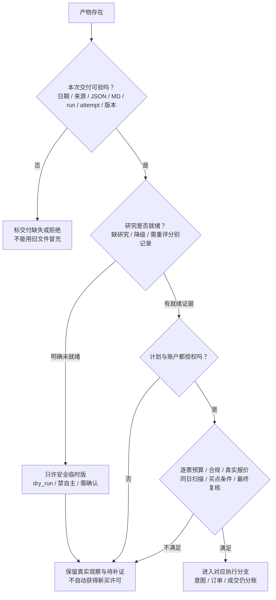
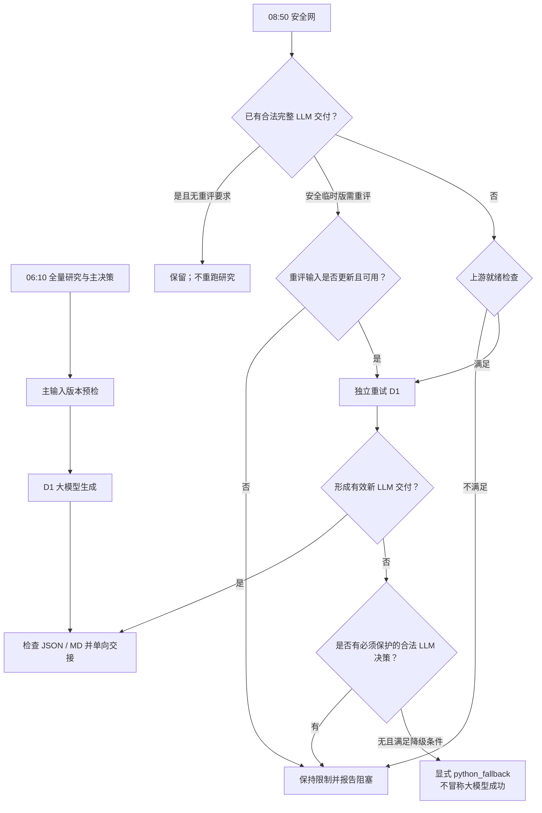
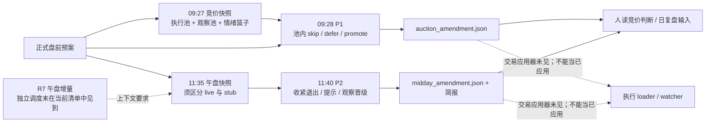

# 架构审阅图与决策路径 · 2026-10-26

> 本机工作树与任务库核对，2026-10-26 CST。配套[系统全景与完整任务表](2026-10-26%20系统架构全景与定时任务数据流.md)、[重构进度与验收边界](2026-10-26%20重构进度与验收边界.md)。保留旧图，不修改身份、技能、调度、风控或交易许可。
>
> **证据图例**：实线＝源码明确调用/读取/交接或当前已登记的任务义务，绝不等同本次业务成功；虚线＝模型应履行但实际消费未独立证明，或尚未接通/待授权的关系。需要区别时在边上直接写明。本文不是从画图反推系统已经实现。

## 1. 总图：研究、决策、执行不是一个黑箱

```mermaid
flowchart LR
    subgraph IN[来源与研究]
        F[源快照 / manifest]
        B[R1 风格 · R4 消息 · R7 资金<br/>并行独立会话]
        R3[R3 情绪热度]
        R2[R2 主线与核心候选]
        C[图表快照]
        R5[R5 个股画像]
        R6[R6 独立反证]
        F --> B
        B --> R3
        R3 --> R2
        R2 --> C --> R5 --> R6
        B --> R6
        R3 --> R6
        R2 --> R6
    end
    subgraph DE[传递与决策]
        S[汇总 / 本轮主输入版本清单]
        V[主链每次尝试前预检]
        D[D1 大模型取舍]
        P[正式计划 JSON + 主 MD]
        S --> V --> D --> P
    end
    B --> S
    R3 --> S
    R2 --> S
    R5 --> S
    R6 --> S
    AUX[错题 / 股性 / 题材锚 / 宏观<br/>预测 / 情绪 / 热度] -.七类辅助接线仍待签.-> D
    P --> J[交付检查<br/>JSON 与 MD 分账]
    J --> RT[校验后单向 runtime 副本]
    RT --> L[交易 loader<br/>叠加账户约束]
    L --> E[盘中扫描 / 最终权限检查]
    E --> X[受限订单意图 / 执行分支]
    P --> PR[独立 paper 单次驱动<br/>需另有模拟授权与本地证据]
    X --> RV[日复盘 / 可卖性追踪]
    PR --> RV
    RV --> EV[周度提案]
    EV -.用户逐项签核后才改变规则.-> D
```

R1—R7 是七类业务单元，并不等于七个独立 profile 或七条定时任务。汇总是确定性文件与版本检查，**不会替 D1 选票**。本轮只证明接线；“Python 预检读过”不能冒充“大模型读过”。

依据：`scripts/research/run_research_shell.sh:158-278`；`scripts/research/build_research_summary.py:294-369`。

## 2. 一份主决策到底怎么形成

以下按职责解释判断路径，**不是声称每条思考义务都已经被代码强制或被真实模型履行**。

| 顺序 | 要回答的问题 | 主要证据/职责 | 输出去向与边界 |
|---|---|---|---|
| ① 市场背景 | 市场在奖励什么？广度、涨停溢价、梯队、炸板及风格如何？ | R1、情绪/热度证据 | 决定风险温度与预算上限；不预设“某情绪节点必配某打法” |
| ② 主线与候选 | 哪些方向有持续资金、叙事共振与辨识度核心？ | R2 消费 R3/R4；R7 提供资金证据 | 形成主/次线和候选，不直接下单；概念池不等于纯度已核验 |
| ③ 个股证据 | 候选的基本面、价格位置、股性、资金和事件能否支持参与？ | R5 对真实 R2 候选画像，图表只作其中证据 | 分清产业逻辑与短期资金逻辑；缺数据保留缺口 |
| ④ 独立反证 | 哪些假设被反证？哪些是不可覆盖的硬否决？ | R6 只读 R1—R5/R7 | 大模型主决策须承接明确 hard_reject；建议项可解释取舍 |
| ⑤ 独立取舍 | 谁只观察、谁可进入计划执行池、何时不能交易？ | D1 综合获准主研究输入 | 执行池、观察池、拒绝原因、反向剧本及仓位；合法空执行池也正确 |
| ⑥ 行为条件 | 符合/超/不及竞价预期怎么办？买卖触发及失效条件是什么？ | D1 计划规则；P1/P2 后续对照 | 计划文本不是成交指令；未知执行谓词不能自动变成可执行条件 |
| ⑦ 权限兑现 | 这个账户、这只票、这个报价和时点真的允许提交吗？ | loader、扫描、执行器、最终下单复核 | 账户只能收紧，不能给计划补权限或把零预算改正数 |

**术语保留用户定义**：低吸是预判当日能涨停、相对涨停价仍低的强势参与，不等于大跌抄底；半路是平开后放量突破压力位跟随。本文不增设策略或参数。当前规则备用算法仍有按风格字符串选通道的固定映射，这只是该分支的实现，不能当作大模型主决策或用户方法论的完整实现。

主决策技能职责：`skills/main_decision_v1/SKILL.md:208-311,339-481,1191-1240`；规则备用分支：`src/plan/d1_algorithm.py:254-353,731-990`。

## 3. 三种“通过”必须拆开

- **交付**：机器 JSON、人读 MD 与本次版本可核验；不能证明研究判断正确。
- **研究就绪**：显式未就绪必须保留安全限制；旧格式缺少就绪标记仍有兼容行为，不能写成“缺字段就已经证明就绪”。独立 paper 对买入要求更强的正向就绪证据。
- **交易许可**：计划与账户双授权、逐票开关及最终边界共同决定；`--mode live`、入池、资格 PASS、观察 promote 都不能单独授权。
- **退出分支单独处理**：买入预算为零/禁止新买不应抹掉合法存量退出；不把一个笼统“停机”框当成所有买卖行为完全相同。

依据：`scripts/research/pipeline_artifacts.py:198-234`；`trading/load_plan.py:83-133,186-213`；`trading/execution_authorization.py:51-105`；`scripts/execute/run_paper_plan_once.py:81-106`。

## 4. 主路径、安全网、规则降级：不要画成同一种决策

**已见差异**：主链每次 D1 前执行 `--verify-inputs`；安全网重试没有调用同一完整版本预检，普通初次检查重点是 R5/R6。安全临时版的重评有更严格时间/path/run 检查，但仍不能画成两入口完全同强度。

**已见规则差异**：规则分支对 R6 否决来源的汇合不如 summary 完整；缺参考价有旧 fallback；顶层决策来源和嵌套标签有不一致风险。不能说规则版与 LLM 等价，也不能用规则兜底掩盖主链失败。

依据：`scripts/plan/ensure_watchlist_plan.py:116-176,241-301,324-381`；`src/plan/main_decision.py:258-350,393-401`；`src/plan/d1_algorithm.py:102-146,579-595`。

## 5. 竞价与午盘：修订建议有产物义务，但交易应用仍有缺口

| 核对项 | 实际接线/限制 | 文档不能怎么写 |
|---|---|---|
| P1 时窗 | 当前任务 09:27/09:28；技能要求 09:29 前；默认只观察 | 不能写成旧 09:23/09:25，也不能保证实际每次准时 |
| P1 采集回退 | 主源批次有有效价则保留该批；整批无有效价才切回退，非逐票自动补齐 | 不宣称每只票都经双源补全 |
| P1 人读版 | 渲染正式计划、快照与修订；并非完整版本/时窗执行核验器 | 人读“超预期”不自动产生买权 |
| 午盘 live | CLI 默认 stub，需 `--live` 或对应显式开关；本轮没跑 | 不凭定时任务叫“快照”就认定真实 live |
| 午盘广度/资金 | live 基础模块主要按计划池 sector stats 聚合，另有三通道分时及分块健康 | 不冒充全 A 股真实涨跌家数/完整主力净流 |
| R7 更新 | 增量实现会原地写回早盘 R7 canonical；当前清单无独立 R7 午盘更新任务 | 不能把同一路径画成全天不变；旧摘要复验可能拒绝新版本 |
| P1/P2 自动应用 | 本次检索并读 loader/watch/executor/paper 入口，未找到修订合并读取路径 | 不画 09:29/13:00 自动 reload 已实现实线 |

证据：`scripts/fetch/run_auction_snapshot.py:145-170,448-525`；`scripts/plan/render_auction_judgment.py:57-172,236-258`；`scripts/fetch/run_midday_snapshot.py:22-36`；`src/fetch/midday_snapshot.py:229-259,302-414`；`src/research/r7_capital_flow.py:375-400`。旧午盘技能仍有 runtime→plans 补拷建议，与现行单向交接冲突；本次只登记，未执行。

## 6. 执行路径：文本条件不能自动变成市场判断

实际机器链：

**正式计划 → 日期/schema/权限校验 → 单向 staging → 账户约束交集 → loaded → 同日扫描 → 会话证据 → 分派 → 最终下单复核。**

| 层 | 已实现的边界 | 仍须明示的限制 |
|---|---|---|
| 计划加载 | 正式源优先；不拿旧 runtime 绕过坏正式源；原子替换 | runtime-only 历史兼容仍存在，不能统一称所有消费者 canonical-only |
| 预算与模式 | 缺失计划预算不由账户补值；零值保持禁买；双边同意才可 live | `risk_limits` 只接收明确字段，未知键拒绝；不能删保护字段来“跑通” |
| 买入资格 | 实际拟提交价的盈亏比、来源/冲突/待复核检查 | PASS 是资格，不是独立许可 |
| 扫描与会话 | 缺/异日/其他票扫描不能复用；新扫描先清旧成功缓存 | 有规则类型不表示所有附加谓词都支持；未知条件及非零溢价约束可能 fail-closed |
| 订单最终边界 | 再核 kill、权限、日期、池、规则、预算、报价和数量 | 不替代策略本身缺失的市场触发判断 |
| 卖出 | 与买预算/买扫描分开；须合法可卖量与报价 | 某些板块切换/量价背离条件实现仍不完整；另有低层精确触发/数量原反例未关闭 |

依据：`trading/entry_selector.py:75-209`；`trading/watcher/session_context.py:21-87`；`trading/watcher/dispatch.py:76-149`；`trading/order/qmt_context.py:139-181,234-308`；`trading/executors/base.py:58-151`。

**两种模拟不要混：**

1. 当前 watcher cron 固定启动 `--mode dry_run`，受理/订单意图日志不能当成交。dry_run 也不天然保证所有路径离线，不应为写文档而调用它。
2. `scripts/execute/run_paper_plan_once.py` 是独立账本单次 driver，需显式模拟授权、本地行情/日历、来源与就绪证明；与真实账户分账，也没有在本次任务清单中证明已自动调度。其结果区分 intents/orders/fills，不能拿第一种日志充第二种成交回执。

## 7. 审阅红点：本轮只记录，不借文档改行为

| 优先级 | 红点 | 收口要求，不是本次已完成 |
|---|---|---|
| P0 | 两个低层卖出触发/数量残余，以及跨进程提交/券商对账未认证 | 保留原失败断言、关闭真实绕过；合法退出不受误阻；未经许可不碰真实账户 |
| P1 | 主链与安全网输入校验不同 | 获准后统一版本/来源判定，覆盖旧文件/错 run/改稿拒绝场景 |
| P1 | 七类辅助输入仍待签；模型实际读取未证 | 按窄来源政策另行授权；实际工具成功事件与采用/拒绝理由分别留证 |
| P1 | P1/P2 自动应用未见 | 先决定是否授权自动应用；实现需绑定原计划版本/时窗/预算与复核，不因报告有 promote 就升权 |
| P1 | 午盘取样口径、R7 增量生产/版本覆盖 | 确认实际 producer、live 参数、来源日期和早午版本，保留真实降级 |
| P1 | 周五进化 17:00 早于日复盘 18:00 | 报缺本周末日输入；调度变更另签，不在本轮挪时刻 |
| P2 | 周末 manifest 与重跑 manifest_intel 的固定读取可能错位 | 对同日首次/重跑分别验消费者，不用旧 manifest 充新输入 |
| P2 | 股性月内重复能力及任务名/注释落后 | 列精确消费者和差异再决定，不能由“重复”自动推出可删除 |

## 8. 实际证据链应当留哪四张收据

1. **交付收据**：谁在何业务日、何次运行/尝试交了哪个 JSON 和 MD，内容版本是什么。
2. **传递收据**：汇总及主决策获准读取清单指向哪些精确版本。
3. **读取收据**：真实模型成功读取这些版本的工具事件；不是仅有 skill 必读要求、Python 预检或文件路径。
4. **裁决收据**：采用/拒绝/延后/未读的理由及对应计划字段。自报采纳不是理解正确，理解也不是成交。

当前主输入前两层已有实现；后两层及辅助接线不能冒认闭环。历史工程回归与本次静态核对均不等于自然调度稳定、交易放行或账户盈利证明。

## 9. 阅读与历史对照

旧 [09-架构审阅图-T1prime.md](09-架构审阅图-T1prime.md) 保留当年设计和待签上下文；本图解释现存实现，不让旧稿的“全用 Agent / 不新增 Python / 周度自动改偏好”等历史表述覆盖当前已批准的分工与签核边界。

完整来源摘要、任务与输入输出证据见[本次证据快照](backups/2026-10-26-architecture-doc-evidence.json)。本轮没有运行图中任何业务流程。
