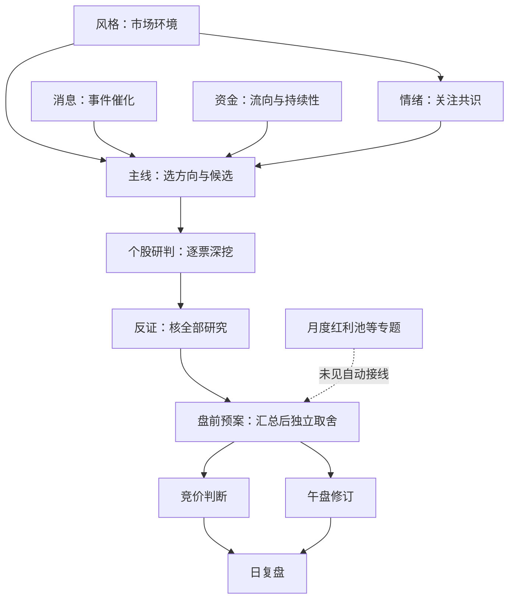
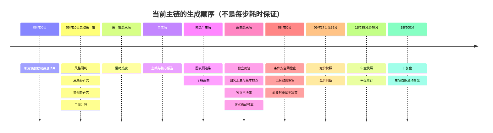
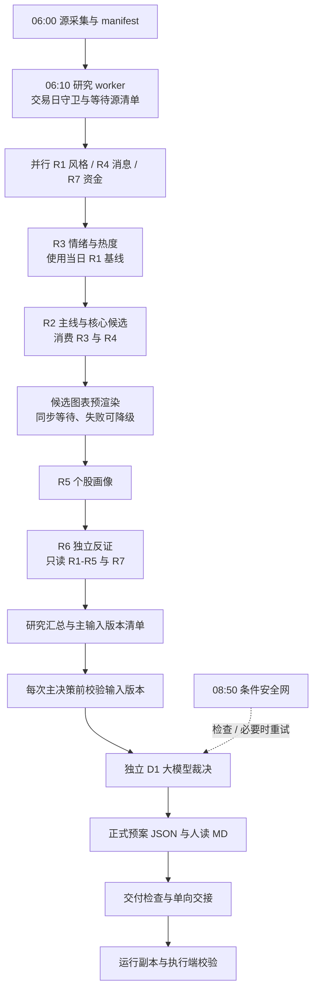
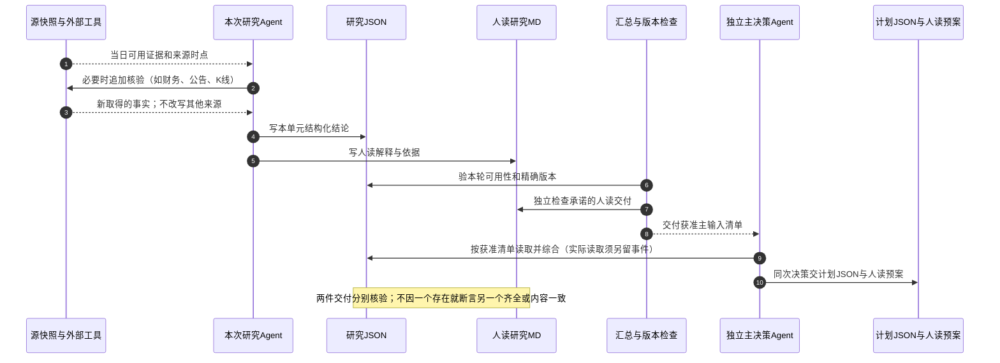
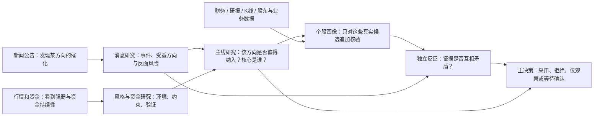
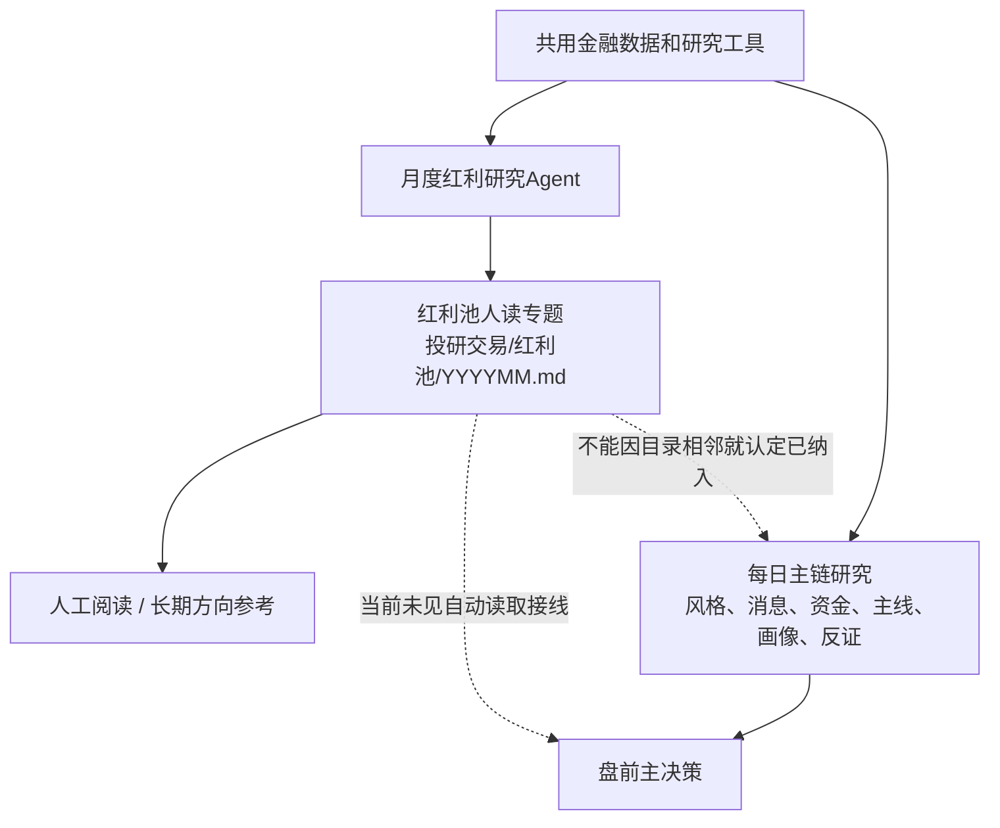

# 系统架构全景与定时任务数据流 · 2026-10-26

> **部署快照，不是新宪法或交易授权。** 本文根据本机源码、Hermes 任务库及当日有限产物头部核对；任务清单取证于 **2026-10-26 15:49:55 CST**，主控于 **15:51 CST** 独立复核任务数量及关键配置一致。本轮未运行生产流水线、模型探针、模拟交易或真实交易。
>
> 范围：本项目与 `/Users/chenyang/.hermes`。召回材料中的 `.hermes-canghai` 是另一部署，不能挪用其“全部跑通”结论。旧文档保留，本文补充当前接线，不更改机器 schema、交易规则、输出路径或任务配置。

## 0. 先用图理解：一条决策主干，几条专题旁支

**最容易混淆的是：同在“投研交易”目录，不代表每份报告都在自动互相读取。** 当前是有依赖的主干，加上尚未全部接入的专题旁支，不是所有报告两两影响。

**读图只记四句话：**

- 风格定背景，消息找催化，资金做验证，情绪看共识；它们在主线研判处汇合。
- 主线先给候选，个股研判再深挖，独立反证找漏洞，盘前预案最后做取舍。
- 竞价和午盘是对已有计划的分时点复核，不是重新生成全市场主线研究。
- 红利池等专题目前不能说已经自动喂给盘前决策。虚线就是缺乏已接通证据，**不是已经生效的影响**。

此图表达已配置的生产路径及技能输入义务，不代表每次模型实际读完。为避免线团，反证输入只画代表线；R6 的完整范围仍是 R1—R5 加 R7。这里“个股研判”指主链 R5 个股画像，不能把知识库中任意一篇个股专题自动当成它的输入。

## 1. 先回答：为什么看起来有很多预案任务

**有很多报告任务，但正式盘前预案只有一条全量主路径和一条条件安全网。**

| 层次 | 实际入口 | 做什么 | 不是做什么 |
|---|---|---|---|
| 全量主路径 | 工作日 06:10，`24f4119fab82` | 七类研究 → 汇总 → 独立大模型主决策 → 正式预案 | 不是七八条各自独立注册的研究 cron |
| 条件安全网 | 工作日 08:50，`af5014f46307` | 检查已有交付，必要时重试主决策；满足前置条件才可显式规则降级 | 不是每天无条件再跑一遍研究；不能覆盖合法大模型不交易结论 |
| 竞价校准 | 09:27 抓快照、09:28 判断 | 对照盘前预期，生成池内修订建议 | 不是另一份完整盘前预案，也没有已证自动应用到交易端的路径 |
| 午盘修订 | 11:35 抓快照、11:40 判断 | 上午表现复核、退出收紧/提示/观察晋级建议及简报 | 不等于执行端已自动改仓或取得新买权限 |
| 辅助研究 | 事件、催化剂、小盘、高分红、股性、题材锚、一字板等 | 提供专题材料、候选或缓存 | 文件生成不等于已接入主决策，更不等于可直接下单 |
| 展示/复盘/健康 | 手机摘要、日复盘、周度提案、台账、知识库同步 | 展示、追踪、诊断或分发 | 不是新的买入决策者 |

主入口证据：`scripts/research/run_research_shell.sh:158-278`；安全网：`scripts/plan/ensure_watchlist_plan.py:324-381`；修订边界：`skills/auction_amendment_v1/SKILL.md:90-146`、`skills/midday_amendment_v1/SKILL.md:114-218`。

## 2. 系统按职责分层，而不是按任务名称数 Agent

| 职责 | 当前实际承载方式 | 主要读写边界 |
|---|---|---|
| 主控对话 | 当前对话；审阅、调度与签核 | 不代替研究选票，不越权代写各角色业务产物 |
| 数据采集 | 确定性脚本为主；部分任务直接由 Agent 执行 | 源快照、manifest、来源状态；也有计算指标写入研究目录，不能只按目录推断角色 |
| 研究 | 全量 shell 中显式 `hermes -p canghai-research chat` | R1—R7 各自 JSON 与约定人读报告 |
| 盘前决策 | shell/安全网显式 `hermes -p canghai-plan chat` | 正式计划 JSON 与知识库主 MD；运行副本由交接代码写 |
| 盘中修订 | 直接 Agent 定时任务 | P1/P2 修订与简报；默认仅观察 |
| 执行 | Python loader / watcher / executor；独立 paper 为另一条路径 | 权限、预算、行情确认、订单状态；当前 watcher cron 明确以 `dry_run` 启动 |
| 复盘与进化 | 日复盘任务位于 default 库；周度进化位于 review 库 | 日报告、观察追踪、错题与待签提案；周度提案不能自动改规则 |

**任务名中的 `canghai-review`、`canghai-phone` 不代表它就在同名角色下运行。** 任务所属库、外层 Agent 身份、脚本内部的 `-p` 是三件事。`no_agent=true` 只表示调度器外层不调用模型；全量流水线和安全网内部仍会启动模型。

本机任务库：default **34** 条；fetch、plan、review 各 **1** 条；research 库 **0** 条。合计 **37 个任务、37 个独立 ID**，全部启用、无暂停。入口类型为 **22 条外层脚本、14 条直接 Agent、1 条脚本后接 Agent**。这些是任务定义，不证明调度服务此刻存活或每条业务产出成功。

## 3. 一天的数据流：先看真正的生产者和消费者

### 3.0 先后顺序：时钟决定启动，依赖决定下一步

**这里没有“主线固定几点几分完成”的承诺。** 只有采集、主链入口、安全网及盘中任务的登记时刻；研究步骤的完成时间随上游耗时变化。主决策在全量任务内部，不是到旧文档的 08:00 就必然另起一次。

红利池不在这条日内串行链里：它登记为**每月 1 日 06:30**独立研究。小盘扩池工作日 06:30、催化剂日历周一 07:30，也不因时钟上早于或晚于 D1，就自动成为 D1 的输入。

### 3.1 盘前主链

图中研究与决策节点表示实际启动路径及任务义务，**不表示本轮模型已被证明读完所有文件**。R1/R4/R7 之后是批次屏障；不是旧图中的 R2/R5 并行，更不是 R1→R2→…→R7 的纯串行。图表步骤的“non-blocking”日志实际表示失败不阻断，命令仍同步等待。

`research_summary.json` 由确定性汇总脚本生成，不负责选股；R 研究和 D1 取舍仍由独立大模型会话完成。不能为了“全是 Agent”而再让模型做文件存在性、版本和清单汇总。

### 3.2 盘中到盘后

| 时点（CST） | 上游 → 生产者 → 产物 | 下游及限制 |
|---|---|---|
| 08:30 | 来源/调度记录 → 数据源台账 | 人工诊断；不能把尚未到期的竞价/复盘报成缺失 |
| 08:30 工作日触发 | 周一/节后首日人气补采，脚本再做日期门控 | 热度材料；晚于 06:10 主链开始，不能默认已进入早班决策 |
| 09:00 | 情绪篮子构建 | 竞价快照可并入篮子；任务名称仍写 08:50，以 schedule 为准 |
| 09:10 | 正式计划及研究 → 手机简报 | 内容压缩与分发，不重新授权买入 |
| 09:27 → 09:28 | 正式计划、情绪篮子 → 竞价快照 → P1 修订 | 09:29 前时窗；人读竞价判断与后续复盘；自动交易应用未接通证据不足 |
| 盘中每 10 分钟 / 每小时 | 市场截面 → 快照/规则摘要 → 小时大模型总结 | 观察与报告，不自动改正式计划 |
| 10:00—11:40 每 20 分钟 | 市场截面 → 退潮后翻多检测 | 转强证据与提示，不自动解除计划/账户禁买 |
| 11:35 → 11:40 | 计划池行情、午盘快照、R7 增量上下文 → P2 | 默认只观察；午盘 CLI 默认 stub，须显式 live；本次没有验证实际运行参数 |
| 17:00 | 全市场日线 → 四色四量/技术指标同步 | 更新数据库；后台已受理不等于已完成 |
| 18:00 | D1、修订、市场与执行证据 → 日复盘 | 结构化报告、观察追踪、错题；不能用场景收益冒充账户成交绩效 |
| 18:00 | 历史预案与行情 → 生命周期滚动复盘 | 最近五交易日窗口、退出与可卖性推演；与独立模拟账本分开 |
| 周五 17:00 | 已有日复盘 → 周度进化提案 | **早于周五 18:00 日复盘**，不能保证覆盖本周最后一天；未改时刻 |
| 19:00 每日 | 公告/事件 → 事件追踪 | 截至生成时刻的快照；次日盘前窗口补晚间新增 |
| 20:30 | 任务及产物状态 → 健康检查 | 报告故障，不是成功交付的替代证据 |
| 22:00 / 22:30 | 次日一字板候选 / 海外数据晚间重抓 | 分别是候选预判和次日输入；不等于晚间再生成完整 D1 |

### 3.3 辅助研究为什么要单独画

七类辅助候选是：**近期错题、股性、题材心智锚、宏观、节点预测、情绪周期、热度**。当前汇总里的默认状态仍是 `pending_approval`，主链 D1 prompt 只允许本次 `artifacts` 指向的主研究输入。

因此存在“专题任务已经生成报告，但未获准自动成为 D1 输入”的情况。R 单元自行引用某材料，也不能证明 D1 直接读了同一份材料。来源清单、模型实际读文件、采用/拒绝理由三层必须分别留证。

证据：`scripts/research/build_research_summary.py:30-38,85-112,357-364`；[辅助输入待签说明](2026-10-25%20辅助研究输入接线待签说明.md)。本次不代签、不应用其补丁。

### 3.4 人读报告是另一个 Agent 凭空写的吗？不是

**主链的正常设计是：一个研究单元在同一次任务中分析输入，交付机器 JSON 和人读 MD 两种表达。下一个单元主要接机器产物继续判断，不是必须先读上一篇人读文章。** D1 同样在独立决策任务中综合主研究，交正式计划 JSON 与人读预案。

所以不是“每篇文章各写各的”，也不是“一律把 JSON 机械翻译成文章”。生产提示词要求 Agent 写两件交付；部分竞价判断、点位表或恢复工具则确实采用**读取既有机器产物再渲染**的方式。不同栏目要看实际 producer，不能统一归成一种生成方式。

**例外要单列**：生命周期滚动复盘确实会解析人读历史预案，因此人读文件也有机器消费者；不能概括成“MD 永远只给人看”。依据：`scripts/review/run_position_lifecycle_review.py:85-99`。

### 3.5 “相互影响”发生在哪一层？在研究结论与候选层，不是数据源互改

这是**逻辑示例，不是当天行情结论**：消息面发现催化，风格/资金告诉我们市场是否奖励这个方向，主线研究据此选候选，个股研判再检验“真受益还是蹭概念”，反证揭示矛盾，最后才决定是否进计划。

- 消息面不会把行情源中的价格“改成更强”；风格研判也不会修改公司的财报。
- 上游结论会改变下游的**注意力、候选范围、核验问题、置信度和风险约束**。这才是相互促进。
- R5 可以对候选再调工具取数；因此不是“06:00 一次抓完以后所有人只读同一个包”。但追加取数也须保留真实时点，不许把后取得的数伪装成更早已知。
- R4 技能允许 R3 已存在时做可选交叉，但当前 R4 与第一批并行、早于当日 R3；**不能画成当日 R3→R4 的必经前置循环**。

上游关系依据：`skills/analyze_main_sectors_v1/SKILL.md:55-66,108-113`、`skills/analyze_stock_profile_v1/SKILL.md:29-56`；可选交叉依据：`skills/analyze_news_impact_v1/SKILL.md:188-190`。

### 3.6 红利池等专题：同一资料库，不等于已经进入日内决策闭环

这条虚线尤其重要：**红利池当前更像平行研究服务，不是已接通的 D1 上游。** 其月度任务定义输出的是专题 MD；本轮在主链 prompt、R2/R5 输入、汇总主清单及活动源码中未找到它被自动读入的证据。小盘扩池、催化剂日历也不能仅凭有报告就宣称“每天帮助主决策选票”。这不是否定专题研究的价值，而是把“人可参考”与“程序自动消费”分开。

事件追踪也有类似细节：R4 技能要求可选读取前晚的结构化事件文件及当日盘前公告窗口，但夜间任务只声明输出人读事件报告，**不能据此认定夜间文章已自动变成 R4 结构化输入**。当日公告窗口的 `anns_window.jsonl` 有直接输入契约，这条腿与夜间文章要分开画。

如果以后要让这些专题促进主线，应先明确来源频率、有效期、候选映射、消费者和采用/拒绝记录，再按权限接线；本轮不以画图代替实施。

## 4. 文件流向：哪份是正式源，哪份只是副本

| 文件/目录 | 生产者 | 消费者 | 权威与时点 |
|---|---|---|---|
| `data/raw/YYYYMMDD/manifest.json` 与源快照 | 采集脚本 | 研究 worker / R 单元 | 抓取清单不是行情观察时间；分别保留源数据日期与抓取时刻 |
| `data/research/YYYYMMDD/R*.json` | 各研究单元 | 后续研究、汇总、获准的 D1 主输入 | 同日旧文件不等于本次尝试已交付；R7 有限定同日别名 |
| `data/research/YYYYMMDD/research_summary.json` | 汇总脚本 | D1 主路径与相关读取器 | 带 run/attempt/文件摘要绑定；不是把全部研究全文塞成一份大报告 |
| `data/plans/YYYYMMDD/watchlist_plan.json` | D1；条件安全网可显式降级 | 竞价/午盘/执行/复盘 | **正式源**；必须区分 `llm` 和 `python_fallback` |
| `chzl_kg/投研交易/盘前预案/YYYYMMDD.md` | 决策角色 | 人工阅读、部分历史复盘 | 人读产物；不是执行端机器授权 |
| `data/runtime/watchlist_plan_YYYYMMDD.json` | 受控交接代码 | 交易 loader 等 | 正式源校验后单向发布；不能反写覆盖正式计划 |
| 同日 `.loaded.json` 等加载产物 | 交易 loader | watcher / executor | 叠加账户约束的工作副本，不是新的研究决策源 |
| `data/plans/YYYYMMDD/auction_amendment.json` / `midday_amendment.json` | P1 / P2 | 人读/复盘义务与部分检查器 | 未找到交易端自动合并应用；禁止画成已生效交易命令 |
| `data/reports/YYYYMMDD/` | 日复盘角色 | 周度进化、人工回看 | 与旧 prompt 的 `data/runtime/E1_data.json` 要求存在差异，需分账核交付 |
| `data/corrections/YYYY-Www/` / `data/evolution/YYYY-Www/` | 日复盘/周度进化 | 获准消费者与用户签核 | 错题及提案不是自动改规则许可 |

两类读取策略不要混写：`src/plan/plan_resolver.py:24-39` 只读正式源，`sync` 是兼容空操作；`trading/load_plan.py:62-67` 在正式源**缺失**时仍保留 runtime-only 历史兼容。正式源已存在但坏掉时，不允许以旧运行副本冒充恢复。

## 5. 不应把这些关系误认成重复跑预案

| 表面重复 | 实际关系 | 当前待核问题 |
|---|---|---|
| 06:10 主链 + 08:50 安全网 | 主路与有条件救援 | 安全网前置校验弱于主链，不能宣称完全一致 |
| 盘前预案 + 竞价判断 + 午盘修订 | 不同时点的计划与差分建议 | 修订尚无已证执行应用器 |
| watcher 启动 + 保活 | 同一进程的启动与缺失重启 | 不能按两条任务数成两套执行系统 |
| 规则盘中摘要 + 小时大模型总结 | 截面生产与解释 | 是否都被实际阅读须另留消费证据 |
| 四个笔记站同步时点 | 同一 wrapper 多次发布 | 这是分发，不是新研究；脚本有写入/发布副作用，审计未运行 |
| 每月 1 日股性 + 每月 18 日股性与题材锚 | 前段能力重合，后段缓存/锚不同 | 列冗余候选，不能未经批准删除任一任务 |

## 6. 当前真实运行切片：有文件不等于主路成功

以下只读**2026-10-26 下午**检查到的头部/存在性，不读取或公开持仓细节，也不代表整个生产系统已全面诊断：

| 目标 | 观察结果 | 不能宣称 |
|---|---|---|
| `data/health/research_pipeline_20261026.json` | `run_id=20261026T061048-3542-1392`，终态 `failed`；D1 第三次尝试于 07:14:18 失败 | 外层 cron 的 ok 等于整链成功 |
| 当日 `research_summary.json` | 06:55:19 生成；`orchestrator_status=partial`，契约检查字段为 true | 契约字段 true 等于所有研究及人读报告已齐 |
| 当日正式 `watchlist_plan.json` | 08:50:56；`decision_source=python_fallback`、`mode=fallback` | 当天大模型盘前主决策已完整交付 |
| 同日 runtime 计划副本 | 检查时未见 | 正式文件存在即可视作已交接执行 |
| 同日 P1 / P2 修订 | 检查时均未见正式文件 | 已按竞价/午盘建议自动调整交易 |

此处 `mode=fallback` 是已见降级文件头部；**不属于交易交接接受的 `live/dry_run` 模式**。其 `contract_checks_passed=true` 不能跨过交易 loader 的模式/权限校验。证据：`trading/load_plan.py:83-111`。

## 7. 全量任务清单（37/37）

**全部启用；下表“最近状态”是 15:49:55 任务库记录，不等于业务交付。** 表达式按本机 CST 解释；工作日表达式本身不感知节假日，是否有交易日守卫须按 wrapper 单独核对。精确输入输出与源码出处保存在本目录的[证据快照](backups/2026-10-26-architecture-doc-evidence.json)。

| # | ID | 任务 | 所属库 | 表达式 | 入口 | 最近状态 | 正式预案角色 |
|---:|---|---|---|---|---|---|---|
| 1 | `dc312e1c10d3` | canghai-execute · watcher start (09:15) | default | `15 9 * * 1-5` | 脚本 | ok | — |
| 2 | `51e960a61f9e` | canghai-execute · watcher keepalive (10m) | default | `*/10 9-15 * * 1-5` | 脚本 | ok | — |
| 3 | `24f4119fab82` | canghai-research · 每日 R1-R7+D1 全量流水线 (06:10) | default | `10 6 * * 1-5` | 脚本 | ok | 主路径 |
| 4 | `cac075214e6f` | canghai-sise · 全市场日线+四色四量增量 (17:00) | default | `0 17 * * 1-5` | 脚本 | ok | — |
| 5 | `354c580574e3` | 沧海巨浪-收盘落盘提醒 | default | `5 15 * * 1-5` | 脚本 | ok | — |
| 6 | `6433ef538744` | canghai-fetch · 盘前全源抓取 (06:00) | default | `0 6 * * 1-5` | 脚本 | ok | — |
| 7 | `bbfa5007d424` | canghai-review · 每日复盘 E1 (18:00) | default | `0 18 * * 1-5` | Agent | ok | — |
| 8 | `6364b9c63227` | canghai-event-tracker | default | `0 19 * * *` | Agent | ok | — |
| 9 | `e9f209e44863` | canghai-insider-tracker | default | `30 19 * * 5` | Agent | ok | — |
| 10 | `8588cd3d9943` | canghai-catalyst-calendar | default | `30 7 * * 1` | Agent | error | — |
| 11 | `a9b5eb63af43` | canghai-small-cap-miner | default | `30 6 * * 1-5` | Agent | error | — |
| 12 | `d49fb5310923` | canghai-dividend-picker | default | `30 6 1 * *` | Agent | ok | — |
| 13 | `f49220d13788` | canghai-health · 每日产出健康检查 (20:30) | default | `30 20 * * *` | 脚本 | ok | — |
| 14 | `d372940a8886` | canghai-fetch · 竞价快照 (09:27) | default | `27 9 * * 1-5` | Agent | error | — |
| 15 | `d5cd79c48615` | canghai-plan · P1 竞价校准 (09:28) | default | `28 9 * * 1-5` | Agent | error | 修订 |
| 16 | `d741b25076a6` | canghai-phone · 早盘简报 (09:10) | default | `10 9 * * 1-5` | Agent | error | — |
| 17 | `5fbc386914cd` | canghai-phone · 复盘推送 (18:30) | default | `30 18 * * 1-5` | Agent | ok | — |
| 18 | `5871f5ca82e4` | chzl-kg · 笔记站同步 (09:30) | default | `30 9 * * *` | 脚本 | ok | — |
| 19 | `99ec8bce24ad` | chzl-kg · 笔记站同步 (18:00) | default | `0 18 * * *` | 脚本 | ok | — |
| 20 | `af5014f46307` | canghai-plan · D1 预案安全网 (08:50) | default | `50 8 * * 1-5` | 脚本 | ok | 条件安全网 |
| 21 | `cffc5928d382` | canghai-fetch · 美股晚间重抓 (22:30) | default | `30 22 * * 1-5` | 脚本 | ok | — |
| 22 | `163b0753e1d8` | canghai-fetch · 竞价情绪篮子构建 (08:50) | default | `0 9 * * 1-5` | 脚本 | ok | — |
| 23 | `e6517ca3c755` | canghai-research · 退潮次日翻多检测 (10:00-11:40) | default | `*/20 10-11 * * 1-5` | 脚本 | ok | — |
| 24 | `637f04b538f5` | canghai-review · 持仓生命周期滚动复盘 (18:00) | default | `0 18 * * 1-5` | 脚本 | ok | — |
| 25 | `579231d3963a` | chzl-kg · 笔记站同步 (08:30) | default | `30 8 * * *` | 脚本 | ok | — |
| 26 | `da49853a1d07` | chzl-kg · 笔记站同步 (12:00) | default | `0 12 * * *` | 脚本 | ok | — |
| 27 | `bb105fc74549` | canghai-health · 盘前数据源台账 (08:30) | default | `30 8 * * 1-5` | 脚本 | ok | — |
| 28 | `8b9ff2eb44f2` | canghai-intraday · 盘中每10分钟截面快照 (#6) | default | `*/10 9-15 * * 1-5` | 脚本 | ok | — |
| 29 | `cae686ec450a` | canghai-intraday · 每小时 LLM 盘中总结 (#6) | default | `5 10-14 * * 1-5` | Agent | error | — |
| 30 | `a48bfe35bbb9` | canghai-yizi · 次日一字板预判 (#7) | default | `0 22 * * 1-5` | 脚本 | ok | — |
| 31 | `f102a8d022bc` | canghai-stock-character · 个股股性月度更新 | default | `40 6 1 * *` | 脚本 | 未记 | — |
| 32 | `4db0fe22a72d` | canghai-weekend · 周末情报包 (周六/周日 18:00) | default | `0 18 * * 6,0` | 脚本→Agent | ok | — |
| 33 | `6124ebf7f3dd` | canghai-fetch · 盘前人气榜补采 (08:30 周一/节后首日) | default | `30 8 * * 1-5` | 脚本 | ok | — |
| 34 | `aa63ac34cdb9` | 股性表月度更新+心智锚重建 | default | `30 18 18 * *` | 脚本 | 未记 | — |
| 35 | `a314bd2ac6bb` | canghai-fetch · 午盘快照(midday-fetch) | canghai-fetch | `35 11 * * 1-5` | Agent | error | — |
| 36 | `75bf632522ce` | canghai-plan · 午盘修订(P2) | canghai-plan | `40 11 * * 1-5` | Agent | error | 修订 |
| 37 | `87d4d030b72b` | canghai-review · 周度进化(E2) | canghai-review | `0 17 * * 5` | Agent | ok | — |

## 8. 已知接线缺口与不变项

- **P0：执行安全残余**仍按原报告保留阻断；不以本文或工程绿测放行实盘。
- **P1：辅助输入、主链/安全网校验差异、P1/P2 自动应用、午盘数据口径与 R7 版本覆盖、周五 E2 早于 E1**，详见[架构审阅图](2026-10-26%20架构审阅图与决策路径.md)。这次只记录，未修实现或调度。
- 当前用户确定的通道口径：**Agent Plan 主用、Coding Plan 仅备选**。不是因为本次梳理就要切套餐、拆五小时窗口或缩减轮数；任务固定模型与角色默认模型另账，本次均不改。
- 前文曾把“减少最大轮数、挪定时任务”列为“不改配置”的做法，分类不准确；它们改变运行参数/调度，应另行授权，不能夹在文档工作里实施。
- 具体完成度、工程证据时点及哪些仍未验收，见[重构进度与验收边界](2026-10-26%20重构进度与验收边界.md)。

## 9. 证据与历史版本

- 源码主链：`scripts/research/run_research_shell_cron_wrapper.sh:18-71`、`scripts/research/run_research_shell.sh:76-149,158-278`。
- 研究交付：`scripts/research/pipeline_state.py:97-180,263-307`、`scripts/research/pipeline_artifacts.py:147-245,318-334`。
- 汇总传递：`scripts/research/build_research_summary.py:248-291,294-369`。
- 执行边界：`trading/load_plan.py:62-183,344-421`、`trading/execution_authorization.py:15-105`。
- 调度来源：本机五份任务库及 wrapper；精确路径、任务记录行号、来源文件摘要见[证据快照](backups/2026-10-26-architecture-doc-evidence.json)。
- [旧重构进度表](07-重构进度表.md)、[旧架构审阅图](09-架构审阅图-T1prime.md)、[旧系统架构全景](10-系统架构全景-v1.md)、[历史 CANONICAL](00-CANONICAL-ARCHITECTURE-v1.md) 全部保留原文。旧时刻、旧角色数量及“唯一权威”自述不能脱离原日期当今天事实。
