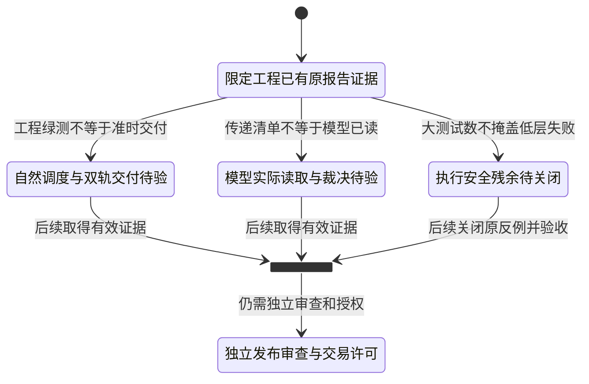

# 重构进度与验收边界 · 2026-10-26

> **结论：两批限定工程修复已有隔离回归证据，生产闭环尚未验收；V1.00 未发布，实盘未放行。**
>
> 本文是 2026-10-26 的新日期版本，保留旧 [07-重构进度表.md](07-重构进度表.md) 原文。不再使用跨研究、执行、部署混算的“总完成率 85%”。本轮完成的是文档/源码/任务库核对，**没有重跑历史测试或生产业务**。

## 1. 授权与本轮变更范围

用户要求：先梳理当前许多定时任务的**数据流、决策路径**，更新系统进化中的进度表、架构审阅图、系统全景；旧文档不丢，可以另写新版本。

本轮落实：

- 新写三篇日期版文档和目录导航；仅补现有阅读入口链接。
- 核对本机 `.hermes` 的任务库与 wrapper，不套用克隆部署 `.hermes-canghai` 的运行记录。
- 保留旧四份架构档案原字节；保留来源摘要、任务清单、证据时点和文档自检结果。
- **Agent Plan 主用、Coding Plan 备选**；没有迁移通道、挪任务时刻、减轮数、改技能/SOUL/凭据/代码/输出路径，亦未补跑任何交易或研究。

配套：[系统全景与完整任务清单](2026-10-26%20系统架构全景与定时任务数据流.md) · [架构审阅图与决策路径](2026-10-26%20架构审阅图与决策路径.md)。

## 2. 先把六类验收拆开

先看图：**当前停在“有限工程证据已取得，但生产/消费/安全还有待验”的位置，不是已经走到发布终点。** 下图是验收层级示意，不是自动发布程序，也不是下一步已获执行授权。

下面的表只作查细节，不再把不同维度压成一个完成百分比。

| 维度 | 当前能负责任地说什么 | 不能说什么 |
|---|---|---|
| 工程回归 | 按 10/24、10/26 原验收报告，限定冻结源码闭包通过对应隔离测试 | 不能当成本轮重跑、全仓绿测、生产进程已加载 |
| 自然调度 | 本次登记到 37 个启用任务；已核任务库、wrapper 与具体时点 | 启用、started/completed/ok 不等于准时完整交付；未认证持续稳定 |
| 机器/人读交付 | 本次版本校验与 JSON/MD 分账实现已补强；当日仍有主决策失败与降级文件 | 不能因有 JSON、schema 过关就称研究和人读报告全齐 |
| 模型实际消费 | 主输入传递/版本检查已有；辅助来源待授权 | manifest、路径引用、采纳自报不证明真实工具读取、理解或正确采用 |
| 执行安全 | 多层共同权限/预算/扫描/报价边界已有限定工程证据 | 两个低层卖出残余及跨进程/券商对账未认证边界不能被大测试数掩盖 |
| 交易许可 | 最新验收档案没有发布 V1.00 或开放实盘 | 文档更新、入池、最小模型调用或“研究就绪”不自动放行 |

## 3. 重构进度表：按能力和剩余缺口，不按故事阶段打勾

“已完成”只覆盖行内限定工程范围；“未验收”不等于从未实现；“待授权”不能借本轮文档工作实施。

| 工作项 | 状态 | 已完成/已有证据 | 剩余收口标准 |
|---|---|---|---|
| 计划与账户共同授权、零预算不升权 | 已完成：限定工程 | 首批修复；账户仅收紧，CLI live 不补权限，最终下单再验 | 生产加载与真实提交/对账另验，不把工程证据变实盘许可 |
| 加载准备与分派分离 | 已完成：限定工程 | `dispatch=False` 仅准备，每轮分派一次的隔离场景通过 | 保留真实调用路径验证与合法存量退出 |
| 独立模拟比例退出与低层买入停机 | 已完成：限定工程 | 固定整数退出目标、保护退出优先、重启/事务与旧单兼容 | 自然模拟订单/成交闭环未因绿测自动完成 |
| 扫描、突破、本票定量、可卖量/卖价 | 已完成：限定工程 | 异日/缺扫描拒买，实际本票限价定量，未知可卖量拒绝 | 真实行情时效、交易时段和账户提交仍需独立验 |
| 低层卖出精确触发和数量 | **部分，P0 未关闭** | 原额外边界 86 项中 84 过、2 失败；正常 wrapper 有保护 | 关闭同类型规则绕过触发、比例规则放大量两个原反例，保留原断言 |
| 跨进程预算/提交原子性与券商对账 | **未验收** | 已列已知边界，非本次研究修复范围 | 在途/成交/撤单、未知提交结果恢复、身份与报价时效分别取证 |
| 本轮 run/attempt/文件版本识别 | 已完成：限定工程 | 第二批 RD-01，旧同日文件不充本次交付 | 自然运行对每单元记录业务终态及精确版本 |
| JSON 与人读 MD 分账 | 已完成：限定工程 | RD-02，缺 MD 不抹有效 JSON，但不假报全部交付 | 按单元/频率核应交分母；五行鲜度检查不代表报告内容质量通过 |
| R7 规范同日别名 | 已完成：限定工程 | RD-03，精确允许同目录、单跳、同日；拒绝越界/异日/链式 | 不扩成全局软链接放行；午盘消费者兼容另核 |
| 汇总→主决策主输入版本绑定 | 已完成：限定工程 | RD-04/05，主链每次 D1 前校验，候选结构错误局部暴露 | 自然主决策真实读取/采用留证；安全网尚未统一同强度预检 |
| 旧规则/备用读取器绕过版本检查 | **最新档案已关闭：限定工程** | RD-06 保留原反例；被拒绝不等于缺失，只有汇总本身真缺失才启原降级 | 旧无 manifest 格式仍有兼容；不追造历史版本收据 |
| 预检后并发改稿窗口 | 部分：保留边界 | 当前前后版本检查可暴露变化 | 没有跨文件事务不可变快照，不宣称竞争窗口消失 |
| 核心研究、汇总、预案准时齐交 | **部分，自然效果未验收** | 交付识别已修；10/26 仍见主链失败、08:50 降级产物 | 按真实截止/run/版本/终态取自然轮次证据，恢复版不倒算准时 |
| 实际候选图表覆盖 | 部分 | R2 后预渲染；汇总按真实 R2/R5 集合核覆盖，未知不填 0 | 每轮核候选版本交集，不以快照存在或固定票数充覆盖 |
| 七类辅助输入窄来源接线 | **待授权，未部署** | 已有明确来源政策和差异草案 | 近期错题/股性/锚/宏观/预测/情绪/热度须精确签核；不扩目录读权 |
| 真实模型读取/裁决与错题闭环 | **未验收** | 传递清单显式 `not_independently_verified`；历史有采纳声明也有漏读 | 成功读取事件与精确输入版本；采用/拒绝/延后/未读理由分账 |
| 角色默认主模型迁移 | 已完成：原最小验收范围 | 10/26 原报告记录六角色默认值回读及新会话模型/工具最小测试 | 只认证默认与最小调用，不认证全链时限/容量/质量或旧会话热更 |
| 任务级固定模型同步 | **本轮不改，另核授权** | 默认迁移报告明确未同步 15 项固定任务 | 不能把“角色已切”写成“所有 cron 已切”；Agent Plan 主用，Coding Plan备选 |
| 竞价/午盘修订与执行应用 | **部分** | P1/P2 有契约与任务，竞价有人读 renderer | 当前未找到执行合并应用路径；时窗/原计划版本/授权复核未完成闭环 |
| 午盘真实数据与 R7 增量版本 | **部分** | 有 live/stub 实现，计划池与分块分时口径可追溯 | 确认实际 live 参数、R7 producer 和早午版本；不冒充全市场完整资金流 |
| 周度进化消费当周有效复盘 | **部分** | 周五 17:00 E2、18:00 E1 已登记；E2 只出提案 | 最后一个交易日 E1 可能缺席；时序调整须另签，不在本轮挪任务 |
| 知识库保守整理 | 已完成：原限定清单；本轮新增导航文档 | 四份历史归档保留；私人材料/Wiki 源快照不作垃圾 | 不扩成整库去重、公开上传或私密材料清理 |
| 网站退役与 data 体量治理 | 待精确授权/验收 | 产品方向收敛，不再为旧 SPA 扩功能 | 无头出图和共享业务依赖要保留，不整删 web/API 或按日期删数据 |
| 回测不污染正式研究 | 未验收，路径变更另签 | 原收敛清单有隔离设计 | 同输入回放与正式业务写路径隔离；本轮不启动回放补成功 |
| V1.00 发布/实盘 | **未发布 / 未放行** | 两批验收均保留部署与交易边界 | 安全残余、自然交付、真实消费、部署加载和授权执行逐项达标 |

实现/验收依据：下方 S1/S2/SM/SP；具体接线新增发现的源码出处见配套架构审阅图。这里的“剩余标准”是后续验收要求，不是新增实现授权。

## 4. 原测试证据怎么读

| 原时点（CST） | 原档案中的结果 | 正确解释 |
|---|---|---|
| 2026-10-24 22:39 | 711 项：698 通过、13 失败，退出 1 | 中间失败历史保留，不用最终结果倒改 |
| 2026-10-24 22:53 | 核心 790 个唯一 case 通过；模拟 65 子测试另列 | 限定工程闭包；额外低层安全边界 86 项中仍有 2 个失败 |
| 2026-10-25 23:24—23:28 | 既修复核 42 项中 41 通过、1 失败；辅助输入草案另有 31 项通过 | 草案未部署；旧读取器的 1 个失败随后在第二批关闭 |
| 2026-10-26 00:18 | 前版本 1,054 项：1,053 通过、1 失败，退出 1 | 原反例未删除 |
| **2026-10-26 00:41:15—00:43:28** | **1,114 个唯一原生测试通过**，已包含首批 790；模拟 65、启动 16 子测试分列 | 不把 790+1,114 相加，不把子测试混进原生数；不掩盖额外两个低层失败 |
| 2026-10-26 00:11:57 前 | 六角色默认模型新会话与最小工具验证通过 | 不是自然生产研究验收，不代表任务固定项迁移 |

**本轮没有执行以上测试。** 只核原报告、证据包位置及源码接线，报告数字的效力停在原冻结源码与原验收时点。完整工作树后续可能变化，不能把旧绿测贴到所有当前文件上。

## 5. 本轮当日运行切片没有“全绿”

2026-10-26 下午只读头部结果：

- 06:10 主链业务状态 `failed`，D1 第三次尝试于 **07:14:18** 结束失败。
- **06:55:19** 的研究汇总状态为 `partial`，不能因契约布尔值为 true 就称齐交。
- 正式计划 **08:50:56** 标为 `python_fallback / mode=fallback`；不是成功的大模型主决策。
- 检查时未见同日 runtime 计划副本及正式 P1/P2 修订文件。仅记录该路径缺口，不借机重生成覆盖。
- **15:49:55** 任务库显示 37/37 启用，最近状态 27 ok、8 error、2 未记。外层主链 cron 可为 ok，但业务状态仍 failed，正好证明两层不是一回事。

这些观察只认证有限元信息，不认证整个 scheduler 服务存活、故障根因已尽查、执行账户状态或成交。当前值/盘后补跑也不能恢复历史竞价窗口。

## 6. 旧表/旧图与现在最重要的区别

| 旧表/旧图的印象 | 新日期版写法 |
|---|---|
| T1 约 85%，T2/T3 未开始 | 按能力/验收维度列状态，不把已有执行和复盘实现重新归零，也不假报全系统完成 |
| 只有两条 active cron，或 24 条任务 | 当前本机 37 条；时点为 10/26 15:49:55，不借用克隆的 37 条状态 |
| R1→…→R7，或 R2/R5 并行 | R1/R4/R7 并行 → R3 → R2 → 图表 → R5 → R6 → 汇总 → D1 |
| 所有任务都必须 Agent；summary 必须模型生成 | 确定性脚本做编排/版本/汇总，大模型做研究与独立取舍，两者不矛盾 |
| 08:00 另有独立 D1 必然交付 | 当前主决策在 06:10 全量任务内部，08:50 有条件安全网；真实成功另验 |
| 09:23/09:25 竞价；15:10 日复盘 | 当前登记 09:27/09:28、11:35/11:40、18:00；周五 E2 17:00 早于 E1 |
| 五个同名 profile 等于五个进程/角色 | 职责、实际身份、任务所属库、脚本进程分表；execute 可由确定性进程承担 |
| 文件生成等于已读；错题声明等于闭环 | 交付、传递、读取、裁决四张收据分开；辅助读取仍待签 |
| P1/P2 生成就会自动 reload | 尚无已证交易应用器；默认观察，不变更买权 |
| runtime 可补拷正式源 | 当前受控交接是正式→runtime 单向；旧反拷建议不执行 |
| WeFlow 核心必需源、周报自动改偏好 | 退役源不擅自恢复；周报仅提案，规则/技能变更仍需签核 |
| 老文档写“唯一权威”即可代表今天 | 文档日期、已批准规则、实际部署证据分别核对，不靠标题裁决 |

## 7. 建议先收口哪件事

**先关闭已知 P0 执行残余并保留不放行状态，其次核自然任务的真实交付和消费；不要先换套餐、拆五小时窗口或继续扩功能。**

| 顺序 | 后续项 | 节省/价值 | 风险及授权边界 |
|---|---|---|---|
| P0 | 低层卖出原反例及提交/对账边界 | 防“上层绿测掩盖低层绕过” | 实现修复与真实账户运行分授权；文档完成不自动许可 |
| P1 | 真实自然轮次交付与消费证据 | 定位哪个生产者/消费者断了，避免整链盲重跑 | 不补造过去时点，不靠规则文件充主路完成 |
| P1 | 主链/安全网一致性与辅助输入窄来源政策 | 减少同日旧文件、漏读、重复分析风险 | 辅助政策仍未批准，不反复催签、不自动应用 |
| P1 | 修订应用与午盘版本/口径 | 避免“报告已改、机器没改”或数据范围夸大 | 是否自动应用先决定；不得因 promote 直接扩买权 |
| P2 | 调度文字/重复能力/周度时序 | 降维护噪声与无效重复 | 先给精确差异；时刻/轮数/配置变更另签 |

## 8. 来源索引与时间效力

| 编号 | 原报告 | 引用重点 |
|---|---|---|
| S0 | [2026-10-24 V1.00 收敛实施清单](2026-10-24%20V1.00收敛实施清单.md) | 原范围、历史固定样本、网站与回测隔离待办；不是部署通过 |
| S1 | [2026-10-24 首批安全修复与联合验收](2026-10-24%20首批安全修复与联合验收.md) | 31—36 行限定验收；191—200 行低层失败与未认证边界；211 行不放行 |
| SP | [2026-10-25 辅助研究输入接线待签说明](2026-10-25%20辅助研究输入接线待签说明.md) | 3、13—35、62—78 行：未批准、来源政策、精确差异与边界；旧读取器残余随后已由 S2 关闭 |
| SM | [2026-10-26 全部角色主模型切换与校验](2026-10-26%20全部角色主模型切换与校验.md) | 默认值与最小调用；34—40 行任务固定项未改 |
| S2 | [2026-10-26 第二批研究交付修复与主控验收](2026-10-26%20第二批研究交付修复与主控验收.md) | 3、19—27、35—48、50—75、111—115、139—148 行，限定闭包与未完成项 |

当前任务、输入输出、来源摘要和旧四文档原始摘要见[本次证据快照](backups/2026-10-26-architecture-doc-evidence.json)。本轮文档自检见[检查结果](backups/2026-10-26-architecture-doc-validation.json)。旧文档不删除、不迁移、不回改历史测试或日期；没有 Git 提交、推送或新同步运行。
