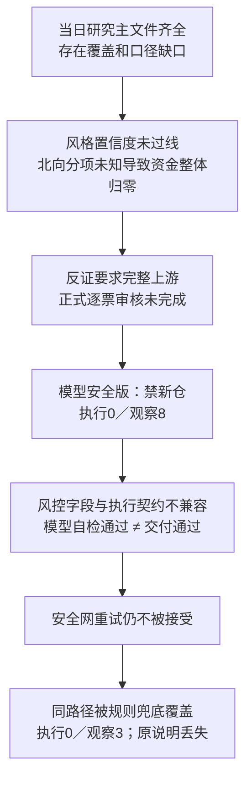

# 六候选签核与盘前空池故障诊断 · 2026-10-27

## 一、授权与核查范围

用户批准此前已展示的三处六候选技能修改，要求继续既有待办，并分析当日盘前预案为什么没有开仓；随后补充结合数据源台账。

本轮只应用这三处技能差异、复跑隔离兼容测试、只读核查当日日志／研究产物／源码并记录结论。没有重跑研究或模型，没有抓行情、访问券商、检查真实账户或改写当日正式预案。本文解释的是预案执行池为什么为空，**不证明真实账户是否成交**。

## 二、结论速览

**有数据缺口，但不是“研究文件全没抓到”；大模型也不是没有运行。** 必须分开两个问题：

1. **为什么模型本来就不准开新仓：** 风格研究置信度低于既有门槛；资金研究因北向净额口径未认证把整体置信度归零；反证只接受完整上游，因此本轮没有完成正式逐票审核。模型两次都报告安全禁新仓、执行池0／观察池8。
2. **为什么你最后看到的是规则兜底：** 模型写出的风控字段通过了宽松的Pydantic模型，却被真正交付／执行边界拒绝。安全网重试没有解决字段问题，最后以Python规则版覆盖了同路径文件，变为执行池0／观察池3。

所以：**禁新仓来自研究就绪门槛；规则报告来自交付契约失败。这不是一次完整研究后“今天没有任何可做机会”的市场结论。** 修好字段也不等于可以开仓，仍须完成研究／逐票门禁与原执行安全要求。

## 三、逐项证据与时间线

### 1. 三处技能已按批准范围应用

目标：`skills/main_decision_v1/SKILL.md`。内容是最多六个合格新机会、维护／退出不挤占新机会展示容量、资格不足不凑票；持仓、订单、单票／板块／总仓与买权不变。

改前备份：`/Users/chenyang/.hermes/cache/scratch/six-candidate-approved-before-l6x84d7f/`。主控逐字比较“原文件依次应用已批三处替换”的结果与当前文件完全一致，未夹带其他技能修改。改后SHA256：`75a183b26893e44a038a36f161b95db6c603db174f945e386f40ef30bd18b9be`。

主控在清空凭据环境及既有隔离runner下重跑六候选真实schema→serializer→loader→报告兼容测试：**8 passed，1.08秒，退出0**。证据：`/Users/chenyang/.hermes/cache/scratch/candidate-capacity-lkzjverl/`。这不证明真实模型已经选出六票，不追溯改变今晨已经运行的决策。

### 2. 研究文件并未整批缺失

`data/health/research_pipeline_20261027.json:6-12`：06:10:19启动，07:14:04结束，`missing_count=0`。R1—R7各阶段均完成交付检查，失败的是主决策阶段与其运行交接。

台账是**08:30:19快照**，当前规则报告是**08:52:34版本**，不是同一时刻的状态：不能把台账中盘前尚未到时的竞价／午盘“待产出”都归为本次故障。台账第68—76行列出涨停、热榜、日行情、板块成员及资金数据成功；第128—149行列出画像所用价格、财务、资金与公告等真实查询成功。

真实缺口包括：部分外盘过期、当日热度文件未产、图片未识别、订阅接口失败，以及北向净额字段口径未认证。部分源已有替代，不是所有标红都导致主决策不能运行。境内研究的观测日2026-10-26为最新完整收盘日；资金产物明确`trading_gap=0`，不能仅因不是10月27日盘中值就叫陈旧。

### 3. 模型已经给过安全禁新仓判断

`data/logs/research_shell/20261027/D1.log:8-12`：原模型交付自述执行0／观察8，理由是R1置信度0.392、R7 unavailable、R6 review_passed=false，研究未完成且须重评。

`D1_llm_retry.log:6-7,53-64`：安全网模型重试把生成时刻更新为**08:52:05**，仍给执行0／观察8，未假造买卖点或RR。

模型自述校验通过不能当作独立交付通过；但这两份日志足以否定当前横幅字面上的“大模型没有产出”。准确说法应是：**模型产生了尚未被交付边界接受的安全临时版**。

### 4. 开仓门槛卡在哪里

- **风格置信度：** 当日R1为0.392。现行技能`skills/main_decision_v1/SKILL.md:1197-1201`明确列有`confidence < 0.4`不开仓条件；不是本轮新增阈值。
- **资金维度被整体归零：** `data/research/20261027/R7_capital_flow_20261027.json:11-31`保留归零前置信度0.2625，明确因北向净额不可得硬覆盖为0。主力、龙虎榜、ETF等T-1数据并非全无；整体unavailable来自这个分项缺口，不是交易日断档。
- **反证未正式审核：** `R6_devil_advocate.json:19-25,77-118`将六个上游均标不可用，正式评估0只，研究候选见到8只、画像见到5只，`review_passed=false`。空hard_rejects表示没有完成正式否决审核，**不是全部审核通过**。

这里值得单独审查“一个分项缺失是否应让整个资金维度归零”和“partial研究是否必须全部拒审”的政策。但**本轮没有擅自放宽任何门槛**，也没有由此授权开仓。

### 5. 明确的工程故障：两套校验契约不一致

流水线业务状态`data/health/research_pipeline_20261027.json:98-105,329-352`记录：进程退出码0，但交付检查失败。报错字段为：

`existing_position_action`、`max_single_sector_pct`、`max_single_stock_pct`、`max_total_position_pct`、`new_position_budget_pct`、`research_temperature_cap_pct`。

- `trading/schema/watchlist_plan.py:110-120`：风险模型允许额外字段，故Pydantic通过并不意外。
- `trading/execution_authorization.py:15-26`：真正执行边界只接受已实现语义的字段，未知风险谓词必须拒绝。
- `scripts/research/pipeline_artifacts.py:216-234`：正式交付会进一步调用执行侧校验，空执行池本身并不被判失败。
- `scripts/plan/ensure_watchlist_plan.py:291-300,353-372`：重试同样过这套校验；未被接受后可进入规则兜底，无法保护这份不兼容字段的模型临时版。

主控从真实源码提取纯校验函数，以**合成输入**离线复现了完全相同的六字段拒绝；改为规范字段但保持零预算时，仍返回零预算禁买原因。未导入项目settings、未读取凭据或调用模型。这验证了：**修字段与取得开仓资格是两件事**。不能删掉无法识别的风控约束来换取“通过”。

证据强度补记：07:14主链的六字段拒绝有业务状态直接留证；08:52重试日志只保存模型输出及改稿差异，没有安全网外层返回的具体异常／退出码。“重试仍因同一字段被拒绝”是这些差异与同一校验源码吻合的强推断，不是本轮直接捕获了第二次异常。没有因此补跑来造证。

### 6. 最后规则报告的“未给”不能都归咎于抓数

并行只读审查返回后，主控另核到更直接的规则空池入口：`src/plan/d1_algorithm.py:292-293`在R2状态非`complete`时**整份提前返回**；当日R2实际为`partial`。因此规则版尚未进入逐票档位或技术通道筛选，就已经得到空候选，也未写逐票淘汰原因。主控提取真实函数，以合成partial输入、不可用画像哨兵和空审计列表离线运行，确认返回空候选且审计仍为空；未调用完整规则生成器、行情或生产写盘。

这也解释了为何原主线龙一／龙二没有进入观察池：第525-534行只直接补候补；前两名因提前返回，没有逐票drop或降级名单可回灌。它们仍在板块总览，不是全文消失。此处为研究可见性／过滤说明缺口，**不把它修成允许买入**；仅恢复观察也不能补齐交易资格。

08:52:34的正式JSON为`python_fallback`、执行0／观察3，与用户贴文一致。规则代码`src/plan/d1_algorithm.py:385-417`按“震荡分化型”固定只开回踩通道；第493—519行的观察条目构造器直接写空`trigger_price`、`entry_rules`、`exit_rules`。因此正文里的大片买卖条件“未给”，至少这一部分是**决策／组装没有生成对应条件**，不是行情接口必然没返回数据。

该兜底仍有固定风格→打法映射，并把决策线回踩标为低吸，不能拿它代表当前正常决策方法。本轮不修改这段规则来冒充模型主链已修好。

### 7. 后续跨日核查：不能把“没成交”全解释为空池

用户随后明确要求北向退出盘前／盘中门槛、仅供复盘参考，并要求追查持续不开仓。并行审查选取最近七个现存日期目录，主控重新读取七份核心计划并核对池数及生成时点，与审查证据一致：

- 10月19／20／21／22／23／26／27日当前执行候选分别为 **2／4／2／0／0／2／0**；空池3日，非空4日。这里统计的是候选，不是订单或成交。
- 五份为`dry_run`、两份为`fallback`。10月22日09:53及23日14:22均为盘中恢复版本，不能冒充开盘授权。因此不能从这些文件证明七天都没开仓，也不能说有候选就已经授予实盘买权。
- 主控直接核10月26／27日独立health记录：连续两日均有风控字段拒收，26日拒收3字段，27日拒收6字段。26日规则版仍有2只执行候选，进一步说明交付失败和空池不是同一问题。
- 审查记录10月22／27日北向缺口被升级为R7整体归零，而23日已有仅参考、不整体归零的处理；说明口径并未稳定固化。R6正式评估为0见于22／23／27日，不是完成审查后全部否决。

证据：scratch `cross_day_gate_audit_20261027/attribution.json`、`attribution.csv`、`findings.json`。主控已重读七份当前计划及两份独立交付错误；未读取真实账户或成交流水。其他跨日标签仍按审查来源及其截止时点理解，不能当作全日加载实证。

后续已核：10月21日当前计划有2只执行候选，却存在未限定个股scope的active RR_FAIL。主控已亲跑隔离纯函数探针：无scope时合成不合格票与合格票均被全局拒绝，明确stock scope则只拦对应票。已有`apply_to_plan`逐票重算并迁移自有旧引擎RR条件后，不合格票仍被拒、合格票仅RR资格通过，真实no_trade与零预算仍阻断。因此这是旧payload／生产消费衔接问题，不能修成消费端无条件忽略全局禁令。**仍未证明10月21日历史进程加载或实际漏单。**

### 8. 北向移出门槛的精确待签差异

已生成`data/evolution/2026-W44/northbound-review-only.pending.patch`及对应manifest。仅涉及四个目标：R7技能、R7规格、主决策技能、日复盘技能。提案阶段`git apply --check`退出0、内存正反向替换通过。用户随后收到差异并重申北向退出门槛及继续施工，**四目标现已应用**；主控逐项核当前SHA等于提案的proposed_sha256，原字节备份在scratch `northbound-approved-before-75hfnux5/`。不冒称今晨旧产物已经重评。

提案取消北向在盘前／盘中的必调、整体时效／置信度、全局禁新和机械仓位调整；北向标not_required，仅复盘参考，不用0／neutral或成交额冒充净流量。不增加默认仓位，不恢复旧覆盖前分数，不把其他缺口自动改complete，不改历史产物、R1门槛、R6审核与逐票条件。

Python资金模块独立北向调用／计分及午间状态耦合已修；主控另补齐已批准规格的applicability标签，真实红测15失败后，冻结相关五文件联合重跑24项通过／0.54秒，守卫违规为空、源码无漂移。该离线实现限定验收，日频午间参考仍degraded、缺主力仍stub，原计算权重和其他门禁不变。主路径仍须由新研究按新契约重新判断，不手改今日旧JSON来解除禁仓。风控schema与执行侧契约一致性尚在独立收口；不以删未知保护换通过。

## 四、前后对比

| 对象 | 改前／被覆盖前 | 本轮之后／当前状态 |
|---|---|---|
| 新机会展示容量 | 技能把候选与最多5持仓混在一起 | 已批准三处改为最多6合格新机会；原执行额度不变 |
| 模型安全版 | 日志记录执行0／观察8，并说明研究未就绪；原版完整字节未在本轮恢复 | 同路径当前是规则0／观察3；本轮未重建或覆盖 |
| 主决策交付 | 六个未知风控字段被严格边界拒绝 | 已复现根因，未删字段、未放宽执行校验 |
| 研究完成与交易资格 | 上游降级、反证未正式审核 | 仍未完成；不因补丁或文件存在而改为通过 |

## 五、根因与非根因

根因是两条链叠加：**不完整研究的全局门槛传播导致模型禁新仓；生产者与消费者的字段契约不一致又导致安全网丢失模型版。**

后续工程进展：风险schema已复用执行侧纯校验，主控冻结新风险＋旧边界全队列521项通过／2.27秒，守卫无违规、19文件无漂移，限定独审无待修。旧边界仅补替身绑定记录与身份／作用域断言，原25测试函数及55条assert保持。安全网防覆盖也已实现，主控新增／原契约及既有force定向联合113项通过／7.86秒，七文件无漂移；只保留有模型来源的失败分析并报具体拒收，不认证、不修字段、不发布未验证计划。防覆盖定向独审待回；当日旧预案未改、正常交付仍未证明恢复。各轮初始失败／脚手架误拦保留在证据目录，不改写为全绿。

当前没有证据把主因归为模型超时、404或额度耗尽；通用兜底横幅不能代替当日日志。新批准的六候选改动不修复这次字段错误，也不解除研究门槛。40%研究仓位上限不是可开40%的交易指令。

## 六、建议排序与审批边界

1. **P0，先统一模型生产者的校验与交付校验。** 在写正式产物前使用相同的风险／执行契约；诊断信息放在合适的非执行元数据位置，真实风险约束必须有明确承载和执行语义，不能静默丢弃。可先完成隔离反例与实现修复；新增技能／提示词／字段语义差异另交签。收益：不浪费整轮研究和第二次模型推理。
2. **P0，保留失败模型版及准确说明。** “字段交付失败／研究仍待重评”与“模型未运行”分开，安全网不应把已有分析抹成泛化规则说明；任何新增持久版本路径先交精确差异。未被执行边界接受的模型文件仍不得下单。
3. **P1，审查降级传播的必要性，而不是把分数调高。** 逐维审查北向缺口与complete-only的依赖，让尚可研究的资料继续被使用；哪些缺口确实阻断交易单独证明。涉及决策门槛／技能变更须另签，未经审核保持现状。
4. **不推荐立即整轮重跑。** 字段问题不改，再次推理仍可能被同处拒绝；输入和就绪规则不变，也不能承诺重跑产生买点。没有在本轮执行重跑。

## 七、变更清单与未尽事项

早盘初验变更为已批准六候选三处及导航／签核／诊断；后续又已应用北向参考化的四目标精确差异。独立Python资金与RiskLimits schema代码整改正在分开施工，尚未主控验收。正式当日研究、预案、运行副本、账户配置、定时任务及交易权限未改，不把进行中的代码记作已恢复生产。

六候选技能子项完成；正常模型自然交付、正文组装生产接线、评分／候补、正式历史消费、预算全调用覆盖、自动修订、调度／退役与卖出持久防重仍分项待做／待签，**总队列没有完成、未生产放行、未实盘放行**。本轮识别的交付契约问题加入既有预案／安全网队列，不新造另一套系统。
