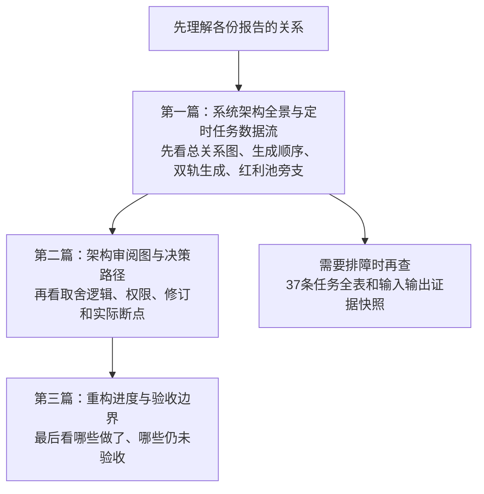

# 系统进化 · 从哪里开始读

> 导航更新：2026-10-26。旧档案保留原文；新的日期版描述本机当时的源码接线与任务快照，不是新宪法、不改变机器契约，也不授予自动交易权限。

## 想先弄清“这些报告究竟有什么关系”

**先看下面第一篇的图，不必从 37 条任务表开始。**

### 本次新写的三篇

1. [2026-10-26 系统架构全景与定时任务数据流](2026-10-26%20系统架构全景与定时任务数据流.md)
   - §0：一条主干与专题旁支；不是所有报告互相读取。
   - §3.0：先后顺序时间线；§3.1：真实研究依赖。
   - §3.4：同一研究任务怎样生成机器 JSON 与人读 MD。
   - §3.5：消息、风格、主线、个股画像怎样改变下游判断。
   - §3.6：红利池等专题目前是平行研究，未见自动接入主决策证据。
   - §7：需要查具体任务时再看完整清单。
2. [2026-10-26 架构审阅图与决策路径](2026-10-26%20架构审阅图与决策路径.md)
   - 研究与决策分层图、交付/就绪/许可分离图、主路与安全网图、竞价/午盘修订图。
   - 实线表示已找到接线或任务义务，不表示本轮模型实际消费；虚线明确未证或待签。
3. [2026-10-26 重构进度与验收边界](2026-10-26%20重构进度与验收边界.md)
   - 有限工程通过，不等于自然交付、模型读完、执行安全和实盘许可。
   - 测试数字带原报告时点；本次文档工作没有重跑历史测试或业务。

技术证据：[任务与来源快照](backups/2026-10-26-architecture-doc-evidence.json) · [文档检查结果](backups/2026-10-26-architecture-doc-validation.json)。不含凭据、真实持仓明细或通信目标；不构成整库公开分享许可。

## 旧文档保留，不需要丢

- [00-CANONICAL-ARCHITECTURE-v1.md](00-CANONICAL-ARCHITECTURE-v1.md)：历史架构与约束来源。
- [07-重构进度表.md](07-重构进度表.md)：旧施工阶段记录。
- [09-架构审阅图-T1prime.md](09-架构审阅图-T1prime.md)：当时设计、待签项与运行快照。
- [10-系统架构全景-v1.md](10-系统架构全景-v1.md)：早期全景。

以上四份原字节保留；不是“删旧换新”，也不把后来的实现倒写成当年已有。旧时刻、旧任务数量和“唯一权威”自述不能脱离原日期代表今天。

## 要追修复历史，再读原验收档案

- [2026-10-24 首批安全修复与联合验收](2026-10-24%20首批安全修复与联合验收.md)：已修保护与未关闭的低层安全残余。
- [2026-10-26 第二批研究交付修复与主控验收](2026-10-26%20第二批研究交付修复与主控验收.md)：本次交付/版本传递/备用读取的一致性。
- [2026-10-25 辅助研究输入接线待签说明](2026-10-25%20辅助研究输入接线待签说明.md)：仍是未批准、未部署的窄来源提案；不因本次画图而生效。
- [2026-10-26 全部角色主模型切换与校验](2026-10-26%20全部角色主模型切换与校验.md)：默认模型最小验收，任务固定项另账。

原有工程阅读地图仍从 [docs/00-阅读指南.md](../../docs/00-阅读指南.md) 进入。契约按真实源码和已批准规则核对，不以本目录的新图替代接口规范。

**本轮不变项：Agent Plan 主用，Coding Plan 备选；未改模型、cron、时刻、轮数、技能、SOUL、风控或业务输出路径，未启动同步/发布/交易。**
