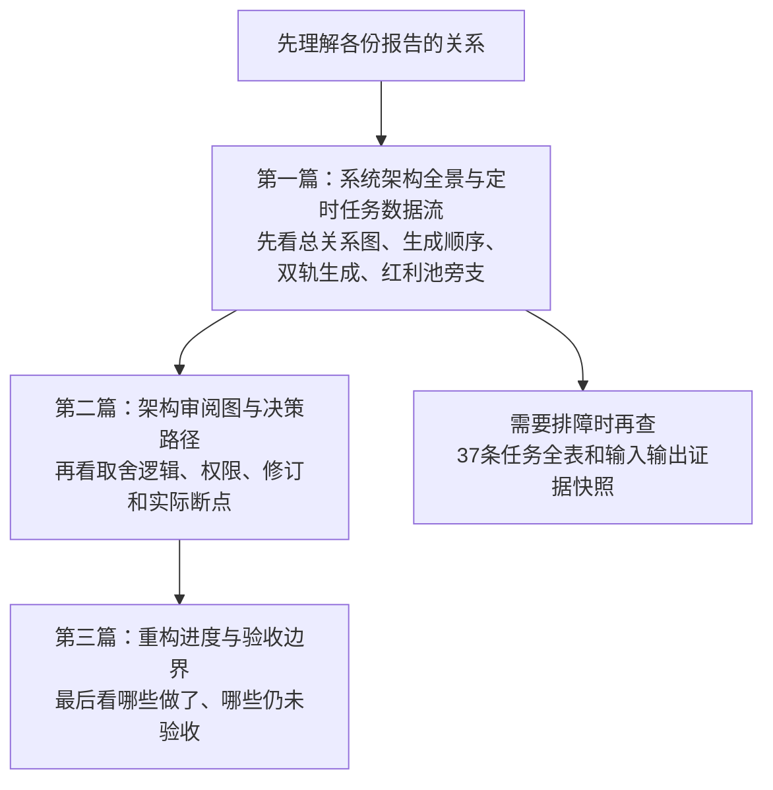

# 系统进化 · 从哪里开始读

> 导航更新：2026-10-26。旧档案保留原文；新的日期版描述本机当时的源码接线与任务快照，不是新宪法、不改变机器契约，也不授予自动交易权限。

## 先看这里：到底要做什么，现在做到哪里

> 2026-10-26 22:43 CST核对。此前把现状图、旧修复报告、需求方案和程序员施工细则混在一起，并同时使用两套阶段编号，造成阅读混乱。**本页统一说明范围和入口，不再新增一份同义总方案。**

> **22:48后范围更新：** 用户明确要求“把这些要新加进去的活都加进去干掉……都一口气干掉它”。下方新需求和旧欠账已统一纳入持续施工队列，不再仅排第一批。代码修复与离线验收按文件所有权并行；配置／技能／调度／生产路径／自动执行许可仍先交精确差异，未批准不生效。纳入不等于做完，实际未过项继续明列。

**最终目标：市场和板块判断更准，已有研究真正用起来，盘前候选与买卖安排更好用；不靠每天人工点票，不靠反复重跑堆推理。**

### 这轮要交付的五件事

1. **先让研究不白跑。** 认证／额度／输入错误及时停，瞬态错误才有限重试；限制所有子任务共用的总预算，异常任务能结束。当前只启动错误分型与隔离测试，预算保护尚待实现和验收。
2. **已有结论接得起来。** 消息、资金、反证、专题和历史复盘先形成有来源、有时点的板块认识，再影响本轮候选；先接一条主线研究链，不让所有角色扩大历史阅读。
3. **先判板块，再看地位与机会。** 分清板块合力、龙头带动、中军承接、先锋待确认、补涨跟随和独立行情；板块与个股双向验证，不以个股分数代替板块效应。
4. **预案能直接比较。** 合格机会足够时提供六只执行候选；执行池、观察池和反向剧本均有买卖速查，给具体价位、条件和失效情形；评分可追溯、可复算，候补有明确激活条件，不提高持仓上限或自动放开买权。
5. **让市场结果改进下一轮。** 预先写下预期，之后区分板块判错、个股选错、买卖点错、无买点和不可成交；经验先成为待证建议，方法／风控变更另审核。

**顺序：先控制重复消耗 → 接有限研究复用 → 改善板块与候选预案 → 用前瞻反馈检验 → 小范围上线。** 表格和候选链路的离线核查可并行，不必等长期评分验证才开始；未通过强制预算前，不开新增付费旁路。

### 当前推进：板块上下文保真与正常模型的复用说明

[板块上下文保真与正常预案接线应用记录](2026-10-28%20板块上下文保真与正常预案接线待签.md)：规则版不再无依据把所有主线标为主力流入，仅保留上游明确状态与已有五项板块上下文。主控380项定向／339项完整报告回归及一次独审完成，09:10内部代码小项关闭。用户随后明确本会话默认批准修改，**已展示的板块复用与旧score来源两段技能差异于09:21精确合并应用**，有私有备份、原字节并集与索引保护，原合成报告流程3项通过；不再重复等待这两份批准。真实评分方法、严格轮次绑定及自然模型采用仍未完成，未新增模型、门禁或交易权限。当前继续既有历史反馈时序，未拿早前冻结回执认证后续变更，整体未完成，2026-10-27早盘重跑仍未启动。

### 已完成：候补状态忠实展示

[来源与状态兼容记录末节](2026-10-27%20真实评分来源透明与兼容边界.md)于16:16限定收口：已有明确受阻、未知／需复核与等待条件不再混称候补，保留禁买锚优先级与原池身份，不重算资格、不自动晋级。主控247项定向、339项完整报告回归通过，三个定向排除CLI已核在完整队列实际通过；一次独审无待修，审查／受测版本匹配当前，十参考和索引不变。此前14:20及14:49回执各保留其冻结版本。整体仍未完成，用户要求“整体完成后使用早盘数据完整重跑”的前提尚未满足，未启动重跑或覆盖当日预案。

### 已完成：规则兜底六候选的残留裁剪

[规则兜底六候选残留裁剪修复](2026-10-27%20规则兜底六候选残留裁剪修复.md)于14:49限定收口：移除早期持仓倍数截断，后期只对最多六个合格新机会计容量，原合格维护不挤名额，超额机会进入原观察／审计路径。主控真实合成生产流程及旧契约联合181项、完整报告339项已通过；一次限定独审无待修，审查／受测版本与当前一致，七参考与索引不变。不改原筛选／排序／风险上限或买权，不冒称正常模型已实际选六只。旧函数本来不因零预算清执行池，本批如实保留零风险值与fallback禁自主身份，不能把展示场景当开仓许可。此前146／339及13:49三组保留其原冻结版本，不替代本批新回归。

### 已完成的小修复及待签：真实评分的来源与使用边界

本批事实、合成证据、最小实现与新增待签差异统一见[真实评分来源透明与兼容边界](2026-10-27%20真实评分来源透明与兼容边界.md)，不是新总方案。内部最小实现于14:20限定收口，主控146项定向／339项完整报告回归通过，原数值／顺序／资格保持，旧测试与索引未变，一次独审无待修且版本匹配当前；新增正常模型来源声明仍未应用。这只是来源透明，不是可复算质量评分完成。

本批只修共享显示与规则版reason的来源提示／股性缺值保真提示，原数值、顺序、资格与输入保持；不是新综合分或排序算法。隔离探针确认：直接`StockEntry`缺分／null拒收，而loader先normalize会把缺键补0；无方法证据的50也可通过。旧分会影响扫描排序纯函数，但未证明当前生产实际采用该链；dispatch也不是按top_buy直接下单。新增正常模型来源声明已生成独立待签差异，未应用、不重问已签报告接线。**本批使用新146／339回归及版本回执收口；13:49旧三组仅保留原冻结版本，不拿来认证后改源码。** 未改schema／权重／排序／权限，真正的质量评分与效果验证仍未完成。

### 你只需区分两个入口

- **需求与验收总方案（给你审阅）：** [市场反馈驱动的认知闭环与分期施工方案](2026-10-26%20市场反馈驱动的认知闭环与分期施工方案.md)，当前v0.4。上述五件事在里面；§4集中说明板块、六只候选、双池表、评分与候补，§5说明消耗保护。
- **具体操作单（给实施者）：** [分批施工实施计划](../../.hermes/plans/2026-10-26_220600-canghai-cognitive-loop-first-tranche.md)。细化了首批四文件修改、失败测试和回归命令；后续各批仍有发现与签核门槛。它不是另一套产品方向，也不是10月26日所有旧欠账的全量施工授权。

**最新限定工程已完成（2026-10-27 13:49）：** [安全网输入同版校验与预算覆盖核查](2026-10-27%20安全网输入同版校验与预算覆盖核查.md)修复兜底重跑启动前后缺少同版输入核验的问题，不新增fallback完整研究门槛。主控定向187项与合成重试4项通过；改后三组112／158／339重新通过、共同594文件摘要一致且匹配当前源码，各队列不加总；一次限定独审无待修，关闭本子项，不继续轮询或同版重复验收。预算真实调用接点的有限核查已完成，但账本尚未接真实发送，总预算、自然模型采用及其他核心余项仍未完成；未新增模型、默认限额、持久目录或交易权限。

**本批启动前的冻结验收：** 北向Python24项、风险同口径521项、模型失败版防覆盖113项及研究观察可见性144项已按原限定工程收口，相关独审无待修。此前跨批三组112／158／339项均已主控通过，在其核验时点三组共同594文件摘要一致且匹配当时源码，队列不加总。该结果保留原版本证据，**不能代替后改源码的复验；本批新验收见上文**。前两次前台超时保留，最终后台重试队列112项在381.58秒完成，不再挂“运行中”。此前六候选8项、卖出121／86／49／72、午盘／回测136项亦保留各自冻结时点。正常生产采用、评分／候补、历史正式消费、自动修订、预算全调用覆盖及旧调度／退役／持久防重仍未完成或待签。**前后两批限定工程已完成，整轮与生产验收未完成，未放行实盘。**

**当前核心已签核应用：** [正常预案报告接线单技能差异及应用记录](2026-10-27%20正常预案报告接线待签.md)。用户明确批准后已精确应用，技能SHA与已签候选一致，应用后合成串联3项复跑通过。模型保留完整原文，在唯一主MD原位附同版JSON表格；不另写越权辅助文件、不模板覆盖原文、不新增模型。技能指令已更新，**自然任务实际读取／采用尚未验证**，不重复索取本次批准。

**旧调度待签（不阻塞当前五项核心施工）：** [股性月度任务合并精确差异](2026-10-27%20股性月度任务合并待签.md)。两任务各有独有后处理，不能直接删；建议保留1号、合入缓存与心智锚并停用18号独立刷新。草案五个合成流程通过，生产配置未动；是否取消18号刷新须用户明确决定，通用“继续todos”不作为批准，亦不与上述报告接线捆绑。

**正文组装的技能接线已应用，实际采用另验：** `src/plan/report_assembly.py`保留模型原文、复用同版JSON表格并以JSON来源为准；当前已签技能要求正常模型显式调用它，但shell未新增自动hook，也没有重跑真实模型。调用方仍须证明正文／JSON属同批且内容一致，模块不能自认证。此前六候选三处签核及8项兼容回归保留原验收范围，候选展示不等于持仓／订单许可或真实模型选满六票。历史清单、R7午盘独立版本、自动修订、预算／卖出账本和任务调整仍另签；summary不能倒接同轮R2，今日旧预案未追溯改写。

**2026-10-27早盘空池诊断：** 已结合08:30台账、主链业务状态、模型日志及08:52规则版核查。禁新仓来自研究就绪门槛；最后变成规则报告则是模型风控字段与交付契约不兼容，不能混称“数据全缺／模型没运行／市场无机会”。[签核与完整诊断](2026-10-27%20六候选签核与盘前空池故障诊断.md)。本轮没有重跑模型、放松门槛或改写当日正式预案；其余队列未完成。

**开盘后追加：** [北向参考化四目标补丁](../../data/evolution/2026-W44/northbound-review-only.pending.patch)已应用。风险同口径、失败版防覆盖及研究观察可见性已按限定工程关闭；保留失败分析或恢复观察不等于认证、看涨判断或买权。RR旧无scope跨票阻断已有合成定位与迁移对照。当前转入改后跨批验证，尚未重写今日旧预案或证明全链恢复，详情见签核日志。

午盘／回测验证边界（2026-10-27凌晨）：主控读取修正实现，亲跑两专项，**136项通过，0.88秒，退出0**，所核七文件无漂移，禁止凭据／正式数据读取、网络／数据库、scratch外写入及删除／替换／重命名。午盘四项与恶意日历清理越界反例按离线范围关闭。真实报价源当前仅给采集HH:MM时会明确降级，不补造源日期来宣称live；原默认stub及生产计算路径不变，未真实采集／回放。证据`/Users/chenyang/.hermes/cache/scratch/parent-midday-backtest-final-tzmlfk71/`。另外必须披露：回测子任务早期测试收集曾触发settings自动读取.env，未输出凭据、未联网；后续隔离加载并在独立守卫下全部重验，本轮主控验证无违规，不能倒称全过程从未读取。

历史适配进展补记（23:12后）：默认关闭的有限历史证据及离线反馈已交回。联合回归暴露旧隔离测试缺少新渲染模块的依赖复制；主控亲自复现后，仅补两份测试的源码复制清单，不删改断言。再次联合运行新增历史／反馈、旧handoff／legacy和双池渲染五个测试文件，**168项通过，7.43秒，退出0**；独立历史代码审查已派发。正式研究读取政策、现有资料转换和事前登记持久化仍未激活，不把合成夹具的反馈链冒充已从真实市场学习。

历史审查及修复：`deleg_5c83ff4f`发现的三项问题已在原范围修复：反馈内部时点绑定承载版本首次可用时间；同一文件描述符单次有界读取并检验身份／SHA、逐级拒绝软链；JSON深度限制与可选包安全降级。23:38后主控读取实现与反例测试，亲跑历史两文件、旧handoff／legacy及delivery五文件，**235项通过，9.92秒，退出0**；运行期间所核12个关联文件无漂移，禁止网络、凭据文件读取及非scratch文件写入。三项整改在默认关闭的离线适配范围内验收；未启用真实历史消费、可信持久事前登记或自动学习，后续跨批最终回归另验。

卖出安全进展补记：省略／伪造持仓状态放大卖量已通过可信组装入口绑定同一活store修复。主控23:57:27起重新冻结源码、亲跑P0 **121通过**、F2当前契约版 **86通过**、C1 **49通过**、I1 **72通过**，四队列守卫无违规、源码无漂移，总退出0。主控AST对比确认迁移保留22个测试函数及参数化／签名、51条静态断言，仅两处wrapper夹具改真store注入，观察输出改scratch；原冻结F2文件SHA未变，其77通过／9失败旧前提结果不改写为绿。限定权威绑定／触发／数量整改验收，**重复提交／并发／重启安全仍未解决，不做总安全结项、不放行实盘**。证据：`/Users/chenyang/.hermes/cache/scratch/low-level-exit-20261026/authority-binding/parent-f2-current-l4hzo7na/`；独立持久卖出账本及路径仍待精确审批，未创建生产库。

后续进展补记（23:08后）：双池共享渲染、隔离父预算账本和进程监督组件已交回；主控真实联合运行三者测试及既有计划staging／产物契约，**121项通过，5.59秒，退出0**，两项独立代码审查已派发。渲染尚未接正常LLM主MD写者，预算尚未接全部真实请求，均不计生产上线。卖出两个原反例已原样复现（原队列84通过、2失败）；根因涉及wrapper内存定量状态，主控已将最小实现范围扩大至`trading/executors/_sell_common.py`与原低层文件，修复继续，不把仅复现算关闭。午盘口径／时间错位、回测正式目录污染及标签顺序修复已进入下一轮独立代码实施。

首批进展补记：错误分型四文件已交回；主控亲自执行分类器、真实脚本隔离可靠性、交付契约与计划staging四个定向测试文件，**112项通过，79.92秒，退出0**，Bash语法与差异空白检查通过。独立只读代码审查`deleg_29b86cd7`已返回，未发现需阻塞或修复的问题；主控于22:57再次核四文件SHA无漂移，**错误分型限定工程结项**。独立审查没有另跑测试，不与主控测试混计。此项不认证父预算、孤儿终止或生产自然交付；实现者原字节与红绿证据保存在`/Users/chenyang/.hermes/cache/scratch/canghai-A0-A6-q6fby2d_/`，后续联合回归仍需冻结跨批版本。

## 10月26日写过的待办，是否全部进了这轮施工？

**此前没有全部排入；用户最新指令后，现已全部进入同一施工队列。**下面表格保留各项实际边界：能实施的代码先做并验收，需要精确配置／权限差异的统一交签，依赖真实生产或前瞻观察的不能用离线绿测销账。不是把旧档案当待办重做，也不等于所有项现在就已具备实施条件。

| 工作 | 与本轮关系 | 下一步／边界 |
|---|---|---|
| 无效整轮重试 | **限定工程已验收**：主控112项通过、独立代码审查无待修项 | 自然生产效果及跨批联合回归仍另验 |
| 主链／安全网重复生产、共享预算与停止传播 | 只读接点已有结果；隔离账本和监督组件实施中 | 生产接线、全部调用覆盖及参数另验，组件通过不能只交计数告警或冒充总门槛通过 |
| 主链／安全网输入版本校验一致性 | 已纳入接点核查，但尚无完整修复补丁 | 复用已有版本校验，另验同日旧文件、改稿和错运行拒绝 |
| 历史研究、Wiki／记忆、错题、辅助输入的实际采用 | 默认不激活的窄适配及真实summary离线集成实施中 | 逐项绑定来源、时点、读取与采用；未经精确政策批准不扩大生产读权 |
| 板块关系、六只候选、双池价位、评分与条件候补 | 双池表格与板块展示实施中；其余统一列入后续接线 | 正常LLM生产者、评分与候补逐项验，不能只改备用Python链路冒充修好 |
| 竞价／午盘建议自动影响执行 | 目标关系已描述，完整自动应用尚未获实施差异批准 | 人读建议与机器已应用分开，原计划版本、时窗和权限逐项验 |
| 午盘真实数据口径、资金增量生产和早午版本覆盖 | 已纳入，精确补丁范围核查中 | 生产者、live参数、数据范围和版本修复独立验 |
| 两个低层卖出触发／数量原反例，跨进程提交及券商对账 | 两个原反例独立修复中；其余交易安全边界保留 | **不能被研究改造覆盖或销账**；未过不放行实盘。研究调用预算≠交易提交预算 |
| 周五进化与末日复盘先后、周末／重跑manifest、股性重复任务 | 已纳入，核消费者与精确差异 | 调度／配置差异交签，不能自动挪任务或删重复 |
| 网站退役、数据体量治理、回测隔离、全系统发布 | 已纳入收口队列，依赖／范围核查中 | 保护共享出图和业务库；删除／迁移须精确清单，不能因研究绿测宣布全系统发布 |

旧欠账出处：[架构审阅图 §7](2026-10-26%20架构审阅图与决策路径.md#7-审阅红点本轮只记录不借文档改行为)、[重构进度 §3](2026-10-26%20重构进度与验收边界.md#3-重构进度表按能力和剩余缺口不按故事阶段打勾)、[第二批原修复报告 §六](2026-10-26%20第二批研究交付修复与主控验收.md#六改进建议)。本表是范围登记，不是新增自动交易或配置变更授权。

## 同日八篇文档是什么关系？不是八套待施工方案

截至上述核对时点，本目录顶层有八篇`2026-10-26*.md`：

| 文档 | 性质与读法 |
|---|---|
| [市场反馈驱动的认知闭环与分期施工方案](2026-10-26%20市场反馈驱动的认知闭环与分期施工方案.md) | **本轮需求和验收主文，优先读** |
| [认知闭环施工方案审阅记录](2026-10-26%20认知闭环施工方案审阅记录.md) | 问题与修订依据；前次独立审阅范围止于v0.2，新增条款另记 |
| [系统架构全景与定时任务数据流](2026-10-26%20系统架构全景与定时任务数据流.md) | 当日下午的现状地图与任务快照，不是待重做清单 |
| [架构审阅图与决策路径](2026-10-26%20架构审阅图与决策路径.md) | 现有路径与缺口地图，红点要登记，不自动扩成本批施工 |
| [重构进度与验收边界](2026-10-26%20重构进度与验收边界.md) | 此前工程与旧欠账，按原时点阅读，不是今晚所有任务已开工 |
| [第二批研究交付修复与主控验收](2026-10-26%20第二批研究交付修复与主控验收.md) | 当日凌晨已做工程的原验收档案，不要重复施工 |
| [全部角色主模型切换与校验](2026-10-26%20全部角色主模型切换与校验.md) | 当日凌晨切到DeepSeek的**历史记录**，不是当前模型策略 |
| [GPT6.1-sol主模型统一与实测记录](2026-10-26%20GPT6.1-sol主模型统一与实测记录.md) | 当晚19:45—19:48的后续迁移验收，取代早先模型策略；不是完整生产验收 |

**已确认的文档时效问题：** 早先图文中的“Agent Plan主用”，以及总方案写作阶段的“未开工／尚待首批批准”，不能继续当作当前状态。原文保留历史，这里追加现状：当晚已统一保存主模型为GPT 6.1 sol，用户随后要求推进并启动了首批实施；后续精确配置、技能、预算和交易授权仍分别审批。不要拿历史声明抵销新指令，也不要把新指令扩张成未知变更全批准。

以下是按问题查图和证据的详细导航；**不需要全部通读才知道要做什么。**

## 想先弄清“这些报告究竟有什么关系”

**先看下面第一篇的图，不必从 37 条任务表开始。**

### 本次新写的三篇

1. [2026-10-26 系统架构全景与定时任务数据流](2026-10-26%20系统架构全景与定时任务数据流.md)
   - §0：一条主干与专题旁支；不是所有报告互相读取。
   - §3.0：先后顺序时间线；§3.1：真实研究依赖。
   - §3.4：同一研究任务怎样生成机器 JSON 与人读 MD。
   - §3.5：消息、风格、主线、个股画像怎样改变下游判断。
   - §3.6：红利池等专题目前是平行研究，未见自动接入主决策证据。
   - §7：需要查具体任务时再看完整清单。
2. [2026-10-26 架构审阅图与决策路径](2026-10-26%20架构审阅图与决策路径.md)
   - 研究与决策分层图、交付/就绪/许可分离图、主路与安全网图、竞价/午盘修订图。
   - 实线表示已找到接线或任务义务，不表示本轮模型实际消费；虚线明确未证或待签。
3. [2026-10-26 重构进度与验收边界](2026-10-26%20重构进度与验收边界.md)
   - 有限工程通过，不等于自然交付、模型读完、执行安全和实盘许可。
   - 测试数字带原报告时点；本次文档工作没有重跑历史测试或业务。

技术证据：[任务与来源快照](backups/2026-10-26-architecture-doc-evidence.json) · [文档检查结果](backups/2026-10-26-architecture-doc-validation.json)。不含凭据、真实持仓明细或通信目标；不构成整库公开分享许可。

## 旧文档保留，不需要丢

- [00-CANONICAL-ARCHITECTURE-v1.md](00-CANONICAL-ARCHITECTURE-v1.md)：历史架构与约束来源。
- [07-重构进度表.md](07-重构进度表.md)：旧施工阶段记录。
- [09-架构审阅图-T1prime.md](09-架构审阅图-T1prime.md)：当时设计、待签项与运行快照。
- [10-系统架构全景-v1.md](10-系统架构全景-v1.md)：早期全景。

以上四份原字节保留；不是“删旧换新”，也不把后来的实现倒写成当年已有。旧时刻、旧任务数量和“唯一权威”自述不能脱离原日期代表今天。

## 要追修复历史，再读原验收档案

- [2026-10-24 首批安全修复与联合验收](2026-10-24%20首批安全修复与联合验收.md)：已修保护与未关闭的低层安全残余。
- [2026-10-26 第二批研究交付修复与主控验收](2026-10-26%20第二批研究交付修复与主控验收.md)：本次交付/版本传递/备用读取的一致性。
- [2026-10-25 辅助研究输入接线待签说明](2026-10-25%20辅助研究输入接线待签说明.md)：仍是未批准、未部署的窄来源提案；不因本次画图而生效。
- [2026-10-26 全部角色主模型切换与校验](2026-10-26%20全部角色主模型切换与校验.md)：默认模型最小验收，任务固定项另账。

原有工程阅读地图仍从 [docs/00-阅读指南.md](../../docs/00-阅读指南.md) 进入。契约按真实源码和已批准规则核对，不以本目录的新图替代接口规范。

**历史边界说明：此前架构图文整理没有改模型或业务配置。当晚主模型迁移独立获批并验收；随后首批错误分型实施已启动。文档导航更新本身不变更时刻、轮数、技能、SOUL、风控或业务输出路径，未验收项目不冒称上线。**
